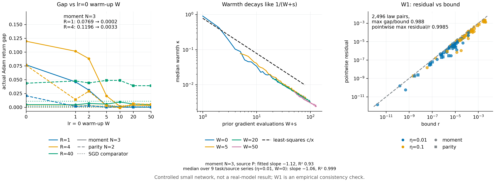

# N12 · 优化器的 warmth 决定一阶反馈统计量 — 实验

[← 框架总览](../README_ZH.md) · [证明](../proofs/N12_optimizer_warmth_ZH.md)

**结论。** N12 成立。检验组 E8 在 1,443,382 个实例、10,825 条断言上通过，逐一确认了节点的各个部分：

- **(W0)**：在 6,944 个经对抗搜索的优化器状态上成立，最佳"左边/右边"比为 $`1.0`$，界是紧的。
- **(W1)**：在全部 2,496 对分布上成立，所用常数在评估任何一对之前就已固定；最大差距/界之比为 0.988。
- **(W2)**：冷启动的分离恰为 $`\lvert w\rvert\eta/2`$。在 warm 状态下，按 preconditioner 步长尺度归一化后的差距按 $`\kappa^{1.00}`$ 缩放，与 W1 归一化项的预言一致。
- **(W3)**：在接近平稳的梯度下，warmth 按 $`1/(W+s)`$ 衰减：$`\eta=0.01`$、$`W=0`$ 时，9 条拟合的 task/source 序列的 log-log 斜率中位数为 $`-1.06`$，$`R^2`$ 中位数为 $`0.999`$。对 warmth 而言，warm-up 评估和真实评估可以互换。
- **短视野**：在受控网络中，$`W=10`$ 的 lr = 0 moment warm-up 消除了短视野下的冷启动窗口差距。moment $`N=3`$、$`\eta=0.1`$ 时，$`R=1`$ 的差距从 0.0769 降到 0.0004，$`R=4`$ 的从 0.1196 降到 0.0016。
- **长视野**：$`R=40`$ 时，warm-up 不再能把差距压到零，$`W\ge10`$ 时仍有至多 0.049 的差距。在残差最大的那些格里，SGD 对照也不为零（至多 0.011），与 W1 中不依赖 warmth 的曲率项一致。


[PDF](../figures/N12_warmth.pdf)

所有数字来自 `theory/v015_checks/results_v015_independent.json → groups[id=E8]`（种子 `[150150,108]`）。受控神经网络设定，不是 Gemma。

## E8-W0 —— 逐坐标的替代误差

**为什么做。** W0 是唯一一处把真实的 Adam 分母换成冻结分母的地方。界 $`\eta u_i\min\lbrace \kappa_i/2,1\rbrace`$ 只要在某处不成立，W1 就跟着不成立。

**设置。**
- 随机状态：$`v`$ 在 $`[10^{-12},1]`$ 上 log-uniform；$`m`$、梯度随机；$`t\in\lbrace 1,\dots,2000\rbrace`$；五组 $`(\beta_1,\beta_2)`$，包括 $`(0.9,0.999)`$。
- 对抗搜索：24 次随机重启 × 80 步爬山，最大化"左边/右边"。
- 运算：差 $`\theta^+-\tilde\theta^+`$ 用有理化的精确运算计算，以避免两个舍入后的更新相减时抵消；同时保留直接的浮点减法结果。
- 容差：只允许 $`10^{-12}`$ 的相对松弛。

**结果**（`data.W0`）。

| 量 | 值 |
|---|---|
| 检验的状态数（`n_instances`） | 6,944 |
| 违例 | 0 |
| 最佳左边/右边（`best_ratio`） | $`1.0000000000000002`$，出现在饱和分支 $`\kappa\gg1`$ |

**说明了什么。** W0 成立，并且不能再改进一个常数因子。当 $`\kappa\to0`$ 时，界的第一支也渐近地紧，因为 $`(1-(1+\kappa)^{-1/2})/(\kappa/2)\to1`$。

## E8-W1 —— warm Adam 在消耗梯度上一阶仿射

**为什么做。** W1 是这个节点的核心结论：在 warm 状态下，消耗梯度均值相同的两个消息分布，response 之差不超过 $`\mathbb E_{P_0}r+\mathbb E_{P_1}r`$；均值不同时不超过 $`\lvert b^\top\Delta\mathbb EG\rvert+\mathbb E_{P_0}r+\mathbb E_{P_1}r`$。

**设置。**
- 状态：受控 [C23](N11_adam_cold_start_ZH.md)（v0.14 受控网络实验，其中 Adam 偏离仿射对照） 网络的实际 warm 状态（$`t`$ 在 21 到 200 之间）。
- 可训练坐标：输出头的 1–4 个坐标，其余坐标固定。
- 消息：每个面板 2–6 条。
- 边界与后缀：一次实际的 Adam 边界，接 $`R\in\lbrace 0,2,6\rbrace`$ 次 IID 参考后缀更新；后缀标签以各 $`1/2`$ 的概率全为 0 或全为 1，$`2^R`$ 条后缀历史全部精确枚举。
- 网格：$`\eta\in\lbrace 0.01,0.1\rbrace`$；部署为 C23 的 moment（$`N=3`$）或 parity（$`N=2`$）回报。
- 常数在评估任何分布对*之前*用预先声明的中心差分估计，事后不放大：
  - $`L_i`$ 沿实际更新到替代更新的线段估计；
  - $`L_v`$ 沿二阶矩线段估计，$`\bar k=1`$；
  - $`H_G`$ 取径向样本和凸包样本上 Hessian 元素绝对值之和。
- $`b`$：用解析的前向灵敏度计算，并与独立的有限差分对照。
- 分布对：均值相同与均值不同两类，随机生成并做对抗搜索。

**结果**（`data.W1`）。

| 量 | 值 |
|---|---|
| 面板数 × 分布对数 | 24 × 104 = 2,496 |
| 违反两分布界的分布对 | 0 |
| 所有分布对中最大的差距/界（`best_ratio`） | 0.988 |
| 最大的逐点 $`\lvert\psi-c-b^\top G\rvert/r`$（`panels[*]`） | 0.998 |
| 解析 $`b`$ 与有限差分 | 每个面板都相差 $`\le10^{-8}`$ |
| 测试状态的 warmth | 每个面板 $`\max\kappa\le0.081`$ |
| 曲率常数与步长 | 例如 moment、$`p=1`$、$`R=0`$：$`\eta=0.01`$ 时 $`H_G=2.1\times10^{-6}`$，$`\eta=0.1`$ 时 $`1.3\times10^{-4}`$ |

**说明了什么。** W1 的界在实际网络状态上、在各种后缀长度和步长下都成立，而且几乎被取到（0.988）。曲率常数大致按 $`\eta^2`$ 增长，与[N12，注记 2](../proofs/N12_optimizer_warmth_ZH.md#注记) 的预期一致。这是用估计常数做的经验一致性检验，不是证书：成立性由证明保证，检验说明界中各残差项确实是起作用的那些项。

## E8-W2 —— 冷启动的分离与 warm 状态下的缩放

**为什么做。** W2 说冷启动状态会在 $`\eta`$ 的一阶上把均值相同的分布分开；W1 说 warm 状态会按 warmth 的比例把这种分离压小。

**设置。**
- 冷启动：W2(a) 的精确有理分布，$`\eta\in\lbrace 0.01,0.1\rbrace`$、$`w\in\lbrace -0.7,1\rbrace`$，分别用理想符号映射和 $`\epsilon=10^{-8}`$。
- warm：同样未缩放的分布，取 $`t=1000`$、$`m=0`$，扫描 $`v`$ 使 $`\kappa_{\max}`$ 取遍 $`[10^{-6},10^2]`$ 中 33 个对数等距的值。

**结果**（`data.W2`）。

| 量 | 值 |
|---|---|
| 冷启动差距，$`\eta=0.01`$，$`w=-0.7`$ | 理想 $`7/2000=0.0035`$；$`\epsilon=10^{-8}`$：$`0.00349999986`$ |
| 冷启动差距，$`\eta=0.1`$，$`w=1`$ | 理想 $`1/20`$；$`\epsilon=10^{-8}`$：$`0.0499999980`$ |
| warm：原始差距对 $`\kappa`$ 的 log-log 斜率（`loglog_slope`） | 1.4995 |
| warm：按 preconditioner 步长尺度归一化后的斜率（`normalized_loglog_slope`） | 0.9995 |

**说明了什么。** 冷启动差距恰为 $`\lvert w\rvert\eta/2`$，是 $`\eta`$ 的一阶量。在 warm 状态下，改变 $`v`$ 会同时改变 $`\kappa`$ 和步长尺度 $`u\propto\kappa^{1/2}`$，所以原始差距按 $`\kappa^{3/2}`$、归一化后的差距按 $`\kappa^{1}`$ 缩放，正是 W1 归一化项 $`\eta\,u\,\kappa`$ 的形式。

## E8-W3 —— warmth 如何演化；warm-up 与真实更新可以互换

**为什么做。** [N12(W3)](../proofs/N12_optimizer_warmth_ZH.md) 依赖平均场速率 $`\bar\kappa(s)\in[1/(\beta_2s),1/(\beta_2^ss)]`$。从它走到实际的 warmth $`\kappa\approx c/(W+s)`$，是这个节点里唯一的近似，所以必须在实际轨迹上检验。

**设置。**
- 轨迹：受控网络中实际的 Adam 训练轨迹（moment 和 parity 任务，$`\eta\in\lbrace 0.01,0.1\rbrace`$，128 个副本）。
- warm-up：在参考分布上做 $`W\in\lbrace 0,1,2,5,10,20,50\rbrace`$ 步 lr = 0 的更新；每一步 warm-up 都断言参数字节不变。
- 记录：每一步各坐标 warmth 的分位数。
- 拟合：对 $`s=1,\dots,79`$ 拟合中位数 $`=c/(W+s)`$，log-log 斜率不固定。

**结果**（`data.W3`）。

| 设置 | 斜率中位数 | $`R^2`$ 中位数 |
|---|---|---|
| $`\eta=0.01`$，$`W=0`$ | $`-1.06`$ | 0.999 |
| $`\eta=0.01`$，$`W\in\lbrace 5,10,20,50\rbrace`$ | $`-1.07`$ 到 $`-1.14`$ | 0.95–0.99 |
| $`\eta=0.1`$，$`W=0`$ | $`-1.18`$ | 0.94 |
| $`\eta=0.1`$，$`W\in\lbrace 10,20,50\rbrace`$ | $`-1.55`$ 到 $`-1.93`$ | 0.55–0.68 |

可互换性：moment $`N=3`$、$`\eta=0.01`$、数据源 $`P`$，在先前评估次数 $`W+s`$ 相同时的 $`\kappa`$ 中位数（`data.W3.per_step`）：

| $`W+s`$ | $`W=0`$ | $`W=5`$ | $`W=20`$ | $`W=50`$ |
|---|---|---|---|---|
| 51 | 0.00661 | 0.00642 | 0.00619 | 0.00619 |
| 79 | 0.00405 | 0.00395 | 0.00413 | 0.00379 |

**说明了什么。**
- 在接近平稳的梯度下（$`\eta=0.01`$），warmth 按 $`1/(W+s)`$ 衰减，与 W3(a) 一致。
- $`\eta=0.1`$ 时，消耗梯度随训练收敛而变小，warmth 衰减得比 $`1/(W+s)`$ 更快，W3(b) 的假设 $`\kappa\le c/(W+s)`$ 满足得更宽裕。
- warmth 取决于吸收过的梯度评估总数，与这些评估来自 warm-up 还是真实更新无关。

## E8 差距扫描 —— 真实网络中的冷启动窗口

**为什么做。** W3(b) 预言了在完整训练中，矩相同的数据源之间的 response 差距如何变化：
- 受 warmth 控制的部分集中在最初几次更新，可以被 warm-up 消除；
- 曲率部分与 warmth 无关，并随视野累积。

**设置。**
- 代码：原样复用 E2 的代码（实际 Adam、冻结 Jacobian Adam、切线仿射 SGD）。
- 网格：5 个任务（moment $`N=2,3,4`$；parity $`N=2,3`$）× $`\eta\in\lbrace 0.01,0.1\rbrace`$ × $`R\in\lbrace 1,4,40\rbrace`$ × $`W\in\lbrace 0,1,2,5,10,20,50\rbrace`$ = 210 格。
- 历史：在各 $`W`$ 和各分支之间完全相同；不超过 4096 条时精确枚举，否则每个数据源 2000 次独立运行。
- warm-up：用参考分布的一个声明好的 IID 前缀。

**结果**（`data.gaps`）。

| 视野 | $`W=0`$ 的差距（各格最大） | $`W\ge10`$ 的差距（各格最大） | $`\lvert`$差距$`(W{=}10)\rvert/\lvert`$差距$`(W{=}0)\rvert`$ | SGD 对照（最大） |
|---|---|---|---|---|
| $`R=1`$ | 0.0769 | 0.0006 | 中位数 0.009，最大 0.034（5 个差距 > $`10^{-3}`$ 的格） | $`R\le4`$ 时为 0.0034 |
| $`R=4`$ | 0.1196 | 0.0064 | 中位数 0.025，最大 0.226（7 格） | （同上） |
| $`R=40`$ | 0.0436 | 0.0487 | 不能压到零 | 0.0110 |

代表性的格：

| 格 | $`W=0`$ | $`W=1`$ | $`W=2`$ | $`W=5`$ | $`W=10`$ | $`W=20`$ | $`W=50`$ | 切线 SGD |
|---|---|---|---|---|---|---|---|---|
| moment $`N=3`$，$`\eta=0.1`$，$`R=1`$ | 0.0769 | 0.0460 | 0.0311 | 0.0032 | 0.0004 | 0.0004 | 0.0002 | 0.0000 |
| moment $`N=3`$，$`\eta=0.1`$，$`R=4`$ | 0.1196 | 0.1016 | 0.0881 | 0.0206 | 0.0016 | 0.0037 | 0.0033 | 0.0000 |
| parity $`N=2`$，$`\eta=0.1`$，$`R=40`$ | 0.0436 | 0.0477 | 0.0441 | 0.0488 | 0.0487 | 0.0391 | 0.0391 | 0.0110 |

$`W\in\lbrace 1,2\rbrace`$ 时 $`\kappa\approx1/(W+1)`$ 仍是 1 的量级，W1 给不出控制，差距可能往任一方向变化。例如 moment $`N=2`$、$`\eta=0.1`$、$`R=1`$ 在 $`W=1`$ 时从 0.0175 变为 $`-0.0194`$。$`W\ge10`$ 时，短视野下的差距一律很小。

**说明了什么。**
- 短视野下，矩相同的数据源之间的差距是冷启动窗口效应。$`W=10`$ 的 lr = 0 moment warm-up 在 $`R=1`$ 时消除了中位数 99% 的差距，在 $`R=4`$ 时消除了 97.5%，与 W1–W3 的预言一致。
- 长视野下，warm-up 不再能把差距压到零。残差最大的两类（$`\eta=0.1`$ 时的 parity $`N=2`$ 和 moment $`N=2`$）在所有 $`W\ge10`$ 下分别保持在 0.039–0.049 和 0.005–0.036，而这些格里的 SGD 对照也不为零（0.011 和 0.0067）。这部分残差是 W1 的曲率/轨迹项在 40 次更新上的累积，SGD 也有，不是冷启动效应。
- 对 few-shot 训练而言，最初几次更新里反馈源需要匹配哪个统计量，由 warmth 决定；在长视野上剩下的，是轨迹的非线性。

（warm-up 是否会改变便宜 proxy 的预测价值，属于方法层面的问题，见节点 [N17](N17_ced_method_ZH.md)。）

## 复现

```bash
CUDA_VISIBLE_DEVICES='' theory/.venv/bin/python theory/v015_checks/check_v015.py --only E8 --output theory/v015_checks/quick/e8.json
```

## 产出文件

- `theory/v015_checks/results_v015_independent.json → groups[id=E8]`：W0、W1 各面板、W2 扫描、W3 的 `per_step` 和 `fits`，以及 210 个 `gaps` 格。
- `theory/v015_checks/figs/E8.png`、`E8_warmth.png`、`E8_W2.png`：原始的图。
- `theory/v015_checks/raw/E8_trajectories.npz`：逐副本的轨迹（被 gitignore；可用上面的命令重新生成；SHA-256 记录在 `data.W3.raw_sha256`）。
- 代码：`theory/v015_checks/warmth.py`（`check_E8`）。
