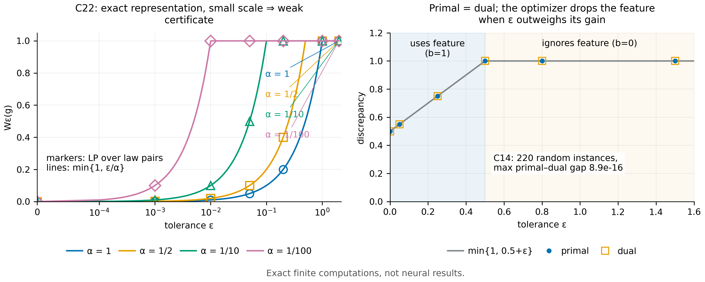

# N13 · 稳定性–近似权衡 — 实验

[← 框架总图](../README_ZH.md) · [证明](../proofs/N13_stability_tradeoff_ZH.md)

**结论.** N13 成立。在所有测试实例上，直接对律对求最大得到的容差差异 $W_{\boldsymbol\epsilon}(g)$，与对偶公式 (36) 在机器精度内相等。支撑这一结论的是下面三组检验：

| 检验 | 实例 | 断言数 | 最坏残差 |
|---|---:|---:|---:|
| C14 | 220 个随机对抗实例 | 2,420 | $9.8\times10^{-13}$（原始–对偶差 $8.9\times10^{-16}$） |
| C22 | 28 个稳定性配置 | 112 | $1.4\times10^{-17}$ |
| 包内检验 | 6 个显式容差 + 36 个随机 LP | — | $8.9\times10^{-16}$ |

C22 在全部 28 个配置上精确复现了闭式解 $W_\epsilon=\min\lbrace 1,\epsilon/\alpha\rbrace $，稳定性项由此一目了然：一个特征哪怕能精确表示 response，只要尺度 $\alpha$ 很小，能证明的也只有 $\epsilon/\alpha$。



[PDF](../figures/N13_stability.pdf)

## C14 · 随机实例上的原始–对偶相等

**动机.** (36) 断言的是一个*等式*：在满足容差的律对中，response 的最坏差异等于对特征系数取最小。如果对偶写错了，或者漏了零质量之类的约束，总会在某个随机实例上出现严格的缺口。

**设置.**

- 随机有限实例：$m\in[3,12]$ 个消息，$d\in[1,m-1]$ 个特征。
- 随机 response $g$ 和特征 $\phi$。
- 随机容差 $\epsilon_j\ge0$，其中包含恰好为零的情形。
- 种子 `SeedSequence([20261010, 14])`。

**做法.** 用 HiGHS 独立求解三个线性规划：

1. 直接用概率变量写出的、对 $(P,Q)$ 的原始最大化；
2. 振幅形式的对偶 $\min_b[\operatorname{osc}(g-\Phi b)+\sum_j\epsilon_j\lvert b_j\rvert]$；
3. 中心化 sup 范数形式的对偶 $\min_{b,c}[2\lVert g-c-\Phi b\rVert_\infty+\sum_j\epsilon_j\lvert b_j\rvert]$。

另外断言三条性质：$W\le\operatorname{osc}(g)$；$\boldsymbol\epsilon=0$ 时退化为 Thm. 8(b)；$\boldsymbol\epsilon$ 很大时 $W\to\operatorname{osc}(g)$。原始 LP 对每个实例都求全局最大，所以这一检验天然是对抗性的。

**结果**（`theory/independent_checks/results_independent_v014.json`，`claims[id=C14]`）：

| 量 | 值 |
|---|---:|
| status | PASS |
| `n_instances` | 220 |
| `n_assertions` | 2,420 |
| `worst_residual` | $9.80\times10^{-13}$ |
| `details.max_duality_residual` | $8.88\times10^{-16}$ |

**说明了什么.** 两种对偶形式与原始问题在每个实例上都一致，包括容差为零和特征秩亏的情形。因此精确对偶按陈述成立，不需要内点条件，也不需要秩条件。

## C22 · 稳定性对照：$\phi=\alpha g$

**动机.** 推论 2 是观察稳定性项最直接的办法。让特征与 response 只差一个尺度，即 $\phi=\alpha g$。这时近似残差为零，但 $\alpha\to0$ 时 certificate 必然变差，因为 $\phi$ 上的容差 $\epsilon$ 只能把 $g$ 限制在 $\epsilon/\alpha$ 之内。

**设置.**

- 二值 response $g$，特征 $\phi=\alpha g$。
- 尺度 $\alpha\in\lbrace 1,\tfrac12,\tfrac1{10},\tfrac1{100}\rbrace $。
- 容差 $\epsilon\in\lbrace 0,\tfrac1{1000},\tfrac1{100},\tfrac1{20},\tfrac15,1,2\rbrace $，共 28 个配置。

**做法.** 分别独立求解概率变量形式的原始 LP 和含噪对偶 LP，再与以精确有理数表示的闭式解 $\min\lbrace 1,\epsilon/\alpha\rbrace $ 比较。

**结果**（`claims[id=C22].details.configurations`；28 行全部与公式一致）：

| $\alpha$ | $\epsilon=10^{-3}$ | $\epsilon=10^{-2}$ | $\epsilon=1/20$ | $\epsilon=1/5$ | $\epsilon\ge1$ |
|---|---:|---:|---:|---:|---:|
| 1 | 0.001 | 0.01 | 0.05 | 0.2 | 1 |
| 1/2 | 0.002 | 0.02 | 0.1 | 0.4 | 1 |
| 1/10 | 0.01 | 0.1 | 0.5 | 1 | 1 |
| 1/100 | 0.1 | 1 | 1 | 1 | 1 |

$\epsilon=0$ 时，对所有 $\alpha$ 差异都为 $0$。最坏残差 $1.39\times10^{-17}$。

**说明了什么.** 即使表示是精确的，certificate 也只能达到 $\epsilon\lvert b\rvert$，其中 $b=1/\alpha$。$\alpha=1/100$ 时，1% 的容差就已让 response 完全不确定（$W=1$）。所以近似残差小本身并不够，系数大小必须进入 certificate，这正是 (36) 所说的。

## 包内检验 · 容差对偶的显式例子

**动机.** 这是理论包中的独立实现，所用例子有闭式解。

**设置.**

- $\mathcal Y=\lbrace 0,\tfrac12,1\rbrace $，$\phi(y)=y$，$g=1\lbrace y=1\rbrace $。
- 闭式解为 $W_\epsilon=\min\lbrace 1,\tfrac12+\epsilon\rbrace $。

**做法.** 在六个容差上求解原始 LP 和对偶 LP，记录见证律和最优系数。另外求解 36 个随机 LP。

**结果**（`theory/v014_repro/results_v014_rerun.json`，键 `noisy_feature_duality`）：

| 容差 | 原始 | 对偶 | 闭式解 | 最优 $b$ | `uniform_residual` |
|---:|---:|---:|---:|---:|---:|
| 0 | 0.50 | 0.50 | 0.50 | 1 | 0.25 |
| 0.05 | 0.55 | 0.55 | 0.55 | 1 | 0.25 |
| 0.25 | 0.75 | 0.75 | 0.75 | 1 | 0.25 |
| 0.5 | 1.00 | 1.00 | 1.00 | 0 | 0.5 |
| 0.8 | 1.00 | 1.00 | 1.00 | 0 | 0.5 |
| 1.5 | 1.00 | 1.00 | 1.00 | 0 | 0.5 |

`uniform_residual` 指最优 $b$ 下的 $\min_c\lVert g-c-b\phi\rVert_\infty$。`random_LP_cases` = 36，`maximum_primal_dual_residual` = $8.9\times10^{-16}$。

**说明了什么.** 当测量代价 $\epsilon$ 超过近似收益时，最优解恰好从使用该特征（$b=1$）切换到忽略它（$b=0$）。(36) 精确刻画的正是这种切换所体现的权衡。

## 复现

```bash
CUDA_VISIBLE_DEVICES='' PYTHONDONTWRITEBYTECODE=1 theory/.venv/bin/python theory/independent_checks/check_v014_independent.py --only C14,C22 --output theory/independent_checks/subset.json
CUDA_VISIBLE_DEVICES='' theory/.venv/bin/python docs/direction/v014_handoff/verify_environment_information_v014.py   # 包内检验
```

## 产物

- `theory/independent_checks/results_independent_v014.json`：`claims[id=C14]` 与 `claims[id=C22]`。
- `theory/v014_repro/results_v014_rerun.json`：`noisy_feature_duality`。
- 规格：`theory/independent_checks/SPEC.md`（C14、C22）。
- 图：`../figures/N13_stability.pdf` 与 `.png`（规格见 `../figures/specs/N13.md`）。
