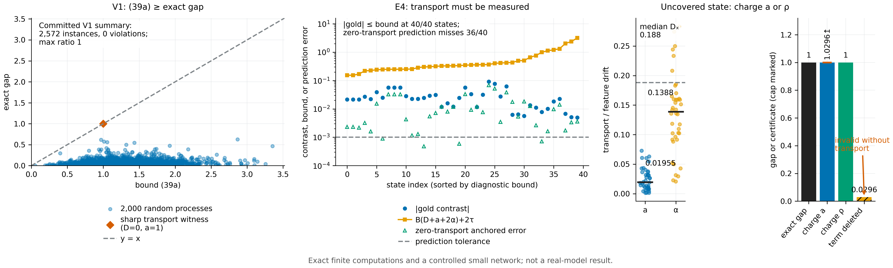

# N14 · 带 transport 的冻结有限接口选择 — 实验

[← 框架总图](../README_ZH.md) · [证明](../proofs/N14_frozen_audit_transport_ZH.md)

**结论.** N14 成立。在 2,572 个精确的有限马尔可夫训练过程上，transport 界 (39a) 从未被违反（V1，最坏残差 0），并在一个尖锐见证上取等（最佳比值 1）。audit 集中性 (37)–(38) 在所有 Monte Carlo 配置上成立（C15）；IID 仿射特例 (40) 在全部 120 个随机实例上成立（V1）。

transport 项是必要的。当一个被训练到的状态没有被任何 audit cell 覆盖时，被 audit 的差异为 0，而学习差距为 1：

- (39a) 对这个状态计入 $a=1$ 或 $\rho=1$，给出 $\ge1$，依然成立；
- 删掉这一项，得到的是 $0.0296$；
- 把一个可达状态的贡献置零，得到 $0$，而差距为 $8/9$。

在受控小网络中，transport 项不可忽略。在 40 个到达状态上（E4），带实测 transport 的局部界在每个状态都包住了真实对比；假设 transport 为零的预测，在 40 个状态中有 36 个失准。

其余支撑检验为 C20、T01 和 T02。



[PDF](../figures/N14_transport.pdf)

## V1 · 精确的有限训练过程

**动机.** (39a) 把停止形式的望远镜恒等式、局部 transport 界和 audit 事件组合在一起。其中任何一环出错，都会产生精确学习差距超过界的实例。V1 在随机和对抗实例上，用有理数算术精确计算两边。

**设置.**

- 有限马尔可夫训练过程：2–4 个被认证状态外加一个退出状态，消息字母表大小 2–4，$R$ 轮。
- 随机的参照与候选 kernel、随机的实际更新、随机的有界终端值。
- 显式的 response 分解 $c+b^\top\phi+r$，精确的 transport 误差 $a_{t,j}(z)$，特征漂移 $\alpha_{zx}$（A5），以及退出概率 $\rho$。
- 种子 `SeedSequence([150150, 1])`；所有数值都是 `Fraction`。

**做法.**

1. 用逆向价值计算精确差距 $\lvert L_E(0)-L_E(j)\rvert$。
2. 独立地正向计算停止后的占据。
3. 计算 (39a)/(A4)，并在 2,000 个随机实例上断言 差距 ≤ 界。
4. 对候选 kernel 做爬山式对抗搜索。
5. 加入下面列出的固定见证，以及 IID 仿射设定 (40) 的 120 个随机实例。

**结果**（`theory/v015_checks/results_v015_independent.json`，`groups[id=V1]`）：

| 量 | 值 | 键 |
|---|---:|---|
| status | PASS | `status` |
| 实例 / 断言 | 2,572 / 28,182 | `n_instances`、`n_assertions` |
| 最坏残差（界 − 差距 的违反） | 0 | `worst_residual` |
| 所有实例中最大的 差距/界 比值 | 1.0（尖锐见证） | `best_ratio`、`data.sharp_transport_witness` |
| 2,000 个随机实例中最大的比值 | 0.736（差距 0.294，界 0.400） | `data.worst_random` |
| 最佳对抗比值 | 0.198（差距 0.220，界 1.114，$\rho=74/75$） | `data.adversarial.best` |
| IID 仿射 (40)：差距 ≤ 界的实例 | 120 / 120；最大比值 1.0；对抗 0.565 | `data.affine_40`、`data.affine_adversarial` |
| 精确 audit 事件概率 (37)，$n=32$，$\delta=0.3$ | 0.99948；最坏选择超出 −0.605（负值表示 (38) 成立） | `data.exact_finite_audit_37_38.best` |

**假设的见证.** 每个见证都说明 (39a) 中某一项不能去掉。

| 见证 | 精确值 | 必须计入什么 |
|---|---|---|
| 未覆盖的训练状态（`data.regression`） | 差距 $=1$；(39a) 取 $a=1$：$1.0296$（截断为 $1$）；取退出 $\rho=1$：$1$；删去 transport 项：$0.0296$ | transport $a$ 或退出 $\rho$ |
| 尖锐 transport（`data.sharp_transport_witness`） | $D=0$，$a=1$，差距 $=$ 界 $=1$ | (39a) 是紧的 |
| 遗漏可达状态（`data.omission_witness`） | 到达概率 $8/9$；差距 $8/9$；把该状态的项置零后界为 $0$；有效的退出界为 $8/9$ | 每个被访问的退出前状态，或 $\rho$ |
| 完整状态（`data.optimizer_state_witness`） | 两个状态都有 $\theta=-1$；$(m,v)=(\tfrac12,\tfrac12)$ 与 $(1,2)$；下一个一阶矩 $-1/8$ 与 $+1/8$ | cell 要定义在完整状态上 |
| 系数大小（`data.coefficient_stability`） | 特征尺度 $10^{-4}$，$B=10^4$，$D=10^{-4}$，残差 0，差距 1 | $B_t$ 乘在 $D$ 上（N13） |

**说明了什么.** 只要假设成立，界就成立，而且能取到；每个假设也都是必需的：

- 可达状态要么带着实测 transport 被覆盖，要么计入退出概率；
- cell 必须是完整的学习者状态，而不是参数 checkpoint；
- 系数以乘法方式进入界。

## C15 · audit 集中性与覆盖见证

**动机.** C15 检验两件事。一是用 Monte Carlo 检验同时成立的 Hoeffding 事件 (37) 和选择不等式 (38)；二是一个精确的、依赖状态的 provider：它在被 audit 的 cell 上与参照一致，在某个被访问的状态上却不一致。

**设置.**

- 四个 audit 配置 $(M,L,d,n_0,n_S,\delta)$，每个 3,000 次独立试验。
- 一个有限学习实例，其中每个 response 恰好等于 $c+b^\top\phi_x$（$\tau=0$），transport 精确。
- 覆盖探针：被 audit 的 cell 为 0，被认证状态为 $\lbrace 0,1\rbrace $，初始状态为 1，更新 $U(z,y)=y$，终端值 $(0,1)$。

**做法.**

- 抽取 audit 样本，记录事件 (37) 是否发生，计算 $\widehat j$ 以及 (38) 和 (39) 的超出量。
- 对探针，计算精确差距，并与"把状态 1 当作已覆盖、但不计 transport 项"所得的表达式比较。

**结果**（`theory/independent_checks/results_independent_v014.json`，`claims[id=C15].details`）：

| $M,L,d$ | $n_0,n_S$ | $\delta$ | 事件频率 | (38) 最坏超出 | (39) 最坏超出 |
|---|---|---:|---:|---:|---:|
| 2,2,2 | 40, 50 | 0.10 | 1.000 | −0.873 | −0.238 |
| 4,3,3 | 100, 80 | 0.05 | 1.000 | −0.573 | −0.500 |
| 3,1,1 | 1000, 1200 | 0.20 | 0.99967（SE 0.00033） | −0.160 | −0.061 |
| 2,2,2 | 8, 8 | 0.40 | 1.000 | −1.626 | −0.477 |

超出量为负，表示不等式以该余量成立。

覆盖探针（`details.coverage_probe`）：被 audit 的经验差异为 $0$，audit 事件概率为 $1$，真实学习差距为 $1$。删去 transport 项后，表达式等于 $0.0296$。

检验套件按设计把 C15 标为 FAIL：这条断言检查的就是"不含 transport 的界在该探针上被违反"。所有 Monte Carlo 断言都通过。

**说明了什么.** 在每个配置下，audit 事件的发生率都不低于名义值 $1-\delta$，(38) 与精确 transport 的 certificate 在事件上成立。这个探针是"被 audit 的状态与被训练的状态不同"的最小情形；在那里，只有像 (39a) 这样计入 transport 或退出的界才成立。

## C20 · 正确特征、遗漏特征，以及带退出惩罚的覆盖

**动机.** 用三个有限对照，把 certificate 的三个组成部分分开：正确的特征覆盖、与决策相关的特征、以及状态覆盖。

**设置.** 一个 response 已知的精确有限学习过程：(i) 正确的特征集；(ii) 去掉一个相关特征；(iii) 训练到达被 audit 集合之外的状态。

**结果**（`claims[id=C20].details`）：

| 对照 | 值 |
|---|---|
| (i) 正确特征，audit $n=120$，$\delta=0.05$ | $\widehat D=1/12$，$e_0+e_S=0.270$。Certificate (39)：$0.354$ ≥ 实际三步更新差距 $1/12$。平方回报任务上取 $C_J=2$ 的仿射 certificate (40)：$0.707$ ≥ 实际差距 $23/216=0.106$ |
| (ii) 遗漏特征 | 两个 provider 在每个被 audit 的特征上都一致，学习价值却相差 $1/2$ |
| (iii) 覆盖 | 差距 $1$；取 $\rho=1$ 时界为 $1$；不计 $\rho$ 时，不含覆盖项的值为 $0$ |

**说明了什么.** 特征和覆盖都正确时，certificate 成立。缺一个特征会留下一个差距，而对其余特征做任何 audit 都看不到它，这就是 Thm. 8（N06）。被访问的未覆盖状态必须通过 $\rho$ 进入。

## E4 · 受控网络到达状态上的 transport

**动机.** 在神经网络学习者中，训练过程会到达新的状态。(39a) 要求在那里计入 transport 项，E4 测量它有多大。E4 还检验：带实测 transport 的局部界 (V)+(A5) 是否包住了实际对比。

**设置.**

- 网络：C23 网络（one-hot 上下文、4 个 tanh 单元、sigmoid、平均交叉熵、float64），用 Adam 训练。
- 锚点：三个实际的参照状态，分别在 0、2、5 次更新之后。被 audit 的差异为 $D_x=0.200, 0.169, 0.188$。
- 到达状态：40 个新状态，位于第 1 到第 13 次更新之间。
- 消息：每个状态上都是同样的四个标量标签。
- Provider 规则：$Q_z=(1-\lambda)Q_3+\lambda\delta_1$，$\lambda=0.1+0.6\,p(\theta_z)$，所以候选律依赖于状态。
- 完整尾部：6 次实际更新，精确枚举。
- 种子 `SeedSequence([150150, 104])`。

**做法.** 在每个到达状态上：

1. 测量相对于其锚点的 transport $a_{t,j}(z)$ 和特征漂移 $\alpha_{zx}$；
2. 拟合 response 分解，记录 $B$ 和 $\tau$；
3. 计算 gold 完整尾部对比；
4. 把它分别与 (a) 假设 transport 为零的锚点预测、(b) 局部界 $B(D_x+a+2\alpha)+2\tau$ 比较。

**结果**（`groups[id=E4].data`；分位数依次为 最小 / 中位数 / 90% / 最大）：

| 量 | 值 |
|---|---|
| 40 个状态上的 transport $a_{t,j}(z)$ | 最小 0.0014，中位数 0.0195，最大 0.0727（`observations[*].a`） |
| 特征漂移 $\alpha_{zx}$ | 最小 0.021，中位数 0.139，最大 0.283（`observations[*].alpha`） |
| 满足 $\lvert$gold$\rvert\le B(D_x+a+2\alpha)+2\tau$ 的状态 | **40 / 40**（断言） |
| 锚点预测误差 | 0.00048 / 0.0063 / 0.0328 / 0.0681（`absolute_error_quantiles`） |
| 误差 $>10^{-3}$ 的锚点预测 | 36 / 40（`failures`） |
| response 残差 $\lvert r\rvert$ | 0.0003 / 0.047 / 0.146 / 0.540（`response_residual_quantiles`） |

**说明了什么.** 在实际到达的状态上 transport 不为零：中位数 0.02，而被 audit 的差异约为 0.2。certificate 必须测量它；测量之后，局部界在所有状态上都包住了真实对比。用零 transport 外推锚点 audit，在 90% 的状态上是错的。局部诊断界的中位数为 0.34，gold 对比的中位数为 0.023，界成立但偏松。因此在神经网络学习者中，有用的信息来自实测 $a$，而不是它的最坏情形大小。

## 包内检验 T01 与 T02

**动机.** 这是 v0.15 理论包中的独立实现。

**结果**（`docs/direction/v015_revision/results_v015.json`，`checks`）：

| 检验 | 结果 |
|---|---|
| T01（未覆盖状态见证） | PASS。差距 $1.0$；transport 界（截断）$1$；退出界 $1$；删去 transport 项后为 $0.0296$ |
| T02（局部 transport 与特征漂移，(A2)–(A5)） | 在 1,200 个实例上 PASS；局部 差距/界 的最大值 $0.503$ |

**说明了什么.** 这两项检验独立确认了必要性见证，以及经漂移修正的局部界 (A5)。

## 复现

```bash
CUDA_VISIBLE_DEVICES='' theory/.venv/bin/python theory/v015_checks/check_v015.py --only V1,E4 --output theory/v015_checks/quick/n14.json
CUDA_VISIBLE_DEVICES='' PYTHONDONTWRITEBYTECODE=1 theory/.venv/bin/python theory/independent_checks/check_v014_independent.py --only C15,C20 --output theory/independent_checks/subset.json
CUDA_VISIBLE_DEVICES='' theory/.venv/bin/python docs/direction/v015_revision/verify_v015_extensions.py   # T01, T02
```

## 产物

- `theory/v015_checks/results_v015_independent.json`：`groups[id=V1]` 与 `groups[id=E4]`。
- `theory/independent_checks/results_independent_v014.json`：`claims[id=C15]` 与 `claims[id=C20]`。
- `docs/direction/v015_revision/results_v015.json`：`checks.T01_*` 与 `checks.T02_*`。
- 规格：`theory/v015_checks/SPEC.md`（V1、E4）与 `theory/independent_checks/SPEC.md`（C15、C20）。
- 图：`../figures/N14_transport.pdf` 与 `.png`（规格见 `../figures/specs/N14.md`）。
