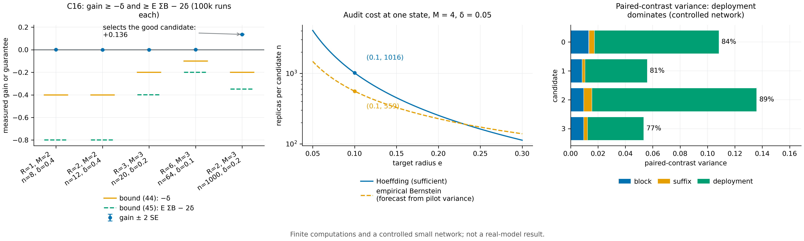

# N15 · Actual-state adaptive auditing; fidelity versus improvement — Experiments

[← Framework map](../README.md) · [Proof](../proofs/N15_adaptive_audit.md) · [中文](N15_adaptive_audit_ZH.md)

**Verdict.** N15 holds. In 5 configurations, each with 100,000 independent training runs (C16), the adaptive audit's measured gain stays above both guarantees: $`-\delta`$ [N15(c)](../proofs/N15_adaptive_audit.md) and $`\mathbb E\sum_tB_t-2\delta`$ [N15(c)](../proofs/N15_adaptive_audit.md). The selected drift exceeds $`\sum_tB_t`$ with frequency 0.990–0.999, above every nominal $`1-\delta`$ (claim a).

The signed identity [N15(b)](../proofs/N15_adaptive_audit.md) and the fidelity bound [N15(a)](../proofs/N15_adaptive_audit.md) hold exactly on 50 rational instances (C21, residual 0). The package's exact expectations (`adaptive_gate_expectations`) agree.

Two witnesses show that the theorem's form is necessary:

- selection without the lower confidence bound has exact expected gain $`-78/15625<0`$;
- conditioning on "all audits passed" moves a zero-drift process from $`1/4`$ to $`119/494`$.

The Hoeffding cost of 1,016 paired replicas per candidate is confirmed (C16, T13). E7 measures the paired variance in a controlled network and *forecasts* that 559 replicas would suffice under an empirical-Bernstein radius. That number is a forecast, not a completed certificate.



[PDF](../figures/N15_adaptive_audit.pdf)

## C16 · Adaptive audit on a finite learning process

**Why.** [N15(c)](../proofs/N15_adaptive_audit.md) makes three claims: a high-probability drift statement (a), and two unconditional expected-value bounds [N15(c)](../proofs/N15_adaptive_audit.md). A violation would appear as a measured gain below $`-\delta`$ or below $`\mathbb E\sum B-2\delta`$, or as a drift-success frequency below $`1-\delta`$.

**Setup.**

- A small finite learning process with 4 states, $`R\le6`$, $`M\in\lbrace 2,3\rbrace`$ candidate kernels per state, and known true advantages.
- Audits sample bounded paired contrasts from the true model: full reference tail plus Bernoulli deployment.
- Selection by the lower confidence bound with $`e_t=\sqrt{2\log(2M/\delta_t)/n_t}`$, followed by a fresh update.
- Stress settings: small $`n_t`$, large $`\delta_t\in[0.1,0.4]`$, and candidates with slightly negative mean and high variance.
- Seed `SeedSequence([20261010, 16])`.

**Procedure.** For each configuration, run 100,000 independent complete trainings (audits plus updates). Then:

- estimate the gain $`L_E(\mathrm{adaptive})-L_E(0)`$ with its standard error;
- check [N15(c)](../proofs/N15_adaptive_audit.md) and [N15(c)](../proofs/N15_adaptive_audit.md) with a 4-SE margin;
- record the frequency with which $`\sum_tA_t\ge\sum_tB_t`$.

**Result** (`theory/independent_checks/results_independent_v014.json`, `claims[id=C16].details.configurations`):

| $`R`$ | $`M`$ | $`n`$ | $`\delta`$ | radius | gain (SE) | $`\mathbb E\sum B`$ | claim (a) frequency | ≥ $`1-\delta`$ |
|---:|---:|---:|---:|---:|---|---:|---:|---|
| 1 | 2 | 8 | 0.4 | 0.759 | 0.00084 (0.00091) | 0.00090 | 0.99412 | ✓ |
| 2 | 2 | 12 | 0.4 | 0.707 | −0.00067 (0.00102) | 0.00088 | 0.99002 | ✓ |
| 3 | 3 | 20 | 0.2 | 0.671 | 0.00003 (0.00106) | 0.00054 | 0.99407 | ✓ |
| 6 | 3 | 64 | 0.1 | 0.429 | 0.00115 (0.00108) | 0.00026 | 0.99628 | ✓ |
| 2 | 3 | 1000 | 0.2 | 0.090 | **0.13638** (0.00097) | 0.05153 | 0.99897 | ✓ |

The status is PASS, with 500,450 instances and 468 assertions. An adversarial search over 327 unique instances found a best margin (bound − gain) of $`-0.199`$: the bound is always below the gain (`adversarial_best_bound_minus_gain`).

**Necessity witnesses** (`claims[id=C16].details`):

| Witness | Value | Meaning |
|---|---|---|
| `point_estimate_exact_gain` | $`-78/15625`$ | Selecting by $`\widehat A`$ without $`-e_t`$ can lose in expectation, so the lower confidence bound is needed |
| `zero_drift_conditioning_witness` | conditional value $`119/494`$ vs unconditional $`1/4`$ (audit failure at state 1: $`9/128`$) | Conditioning on audit success biases terminal value, so [N15(c)](../proofs/N15_adaptive_audit.md) must be unconditional |
| `conditioning_probe_found_45_violation` | false (5 configurations searched) | The unconditional bounds are not violated, even though conditional ones are biased |
| `replicas_required_per_candidate` | 1016 | Hoeffding allocation for $`M=4,\delta=0.05,e=0.1`$ |

**What this shows.** The guarantees hold at their stated strength and no stronger:

- with few replicas and large $`\delta`$, the audit almost never selects, and the gain stays within the $`-\delta`$ floor;
- with enough replicas ($`n=1000`$), it selects the beneficial candidate and gains $`0.136`$, well above $`\mathbb E\sum B-2\delta`$.

## C21 · Signed identity and fidelity versus improvement

**Why.** [N15(b)](../proofs/N15_adaptive_audit.md) is an exact identity for history-dependent provider choices, and [N15(a)](../proofs/N15_adaptive_audit.md) separates fidelity from improvement. Both are checked exactly.

**Setup and procedure.**

- 50 rational finite processes with state-dependent kernel selection, plus an adversarial search on $`\mathrm{LHS}-\mathrm{RHS}`$.
- Three fidelity examples: a good reference ($`\gamma>0`$), an ineffective one ($`\gamma<0`$) and a neutral one ($`\gamma=0`$), each paired with a candidate of fidelity $`\varepsilon=1/100`$.

**Result** (`claims[id=C21]`): PASS, 834 assertions, worst residual 0, `adversarial_best_lhs_minus_rhs` = 0.

| initial | reference | candidate | $`\gamma`$ | $`\varepsilon`$ | candidate gain | [N15(a)](../proofs/N15_adaptive_audit.md): gain ≥ $`\gamma-\varepsilon`$ |
|---:|---:|---:|---:|---:|---:|---|
| 1/2 | 4/5 | 79/100 | 3/10 | 1/100 | 29/100 | ✓ (equality) |
| 1/2 | 2/5 | 39/100 | −1/10 | 1/100 | −11/100 | ✓ (equality) |
| 1/2 | 1/2 | 49/100 | 0 | 1/100 | −1/100 | ✓ (equality) |

**What this shows.** The signed telescoping identity is exact. A high-fidelity copy of an ineffective reference does not improve the initial student: its gain is $`-0.11`$. Fidelity inherits only the reference's measured gain.

## Package check · Exact adaptive-gate expectations

**Why.** This is an independent exact computation, with no Monte Carlo, of [N15(c)](../proofs/N15_adaptive_audit.md) and of the necessity of the $`-\delta`$ term.

**Result** (`theory/v014_repro/results_v014_rerun.json`, `adaptive_gate_expectations`; $`n=400`$ per candidate, $`\delta=0.05`$, radius $`0.136`$):

| Quantity | Value |
|---|---:|
| unconditional expected gain | 0.200 |
| $`\mathbb E\sum`$ selected LCB | 0.132 |
| [N15(c)](../proofs/N15_adaptive_audit.md) lower bound $`-\delta`$ | −0.050 |
| [N15(c)](../proofs/N15_adaptive_audit.md) lower bound $`\mathbb E\sum B-2\delta`$ | 0.032 |
| failure probability | $`1.5\times10^{-8}`$ |
| no exact non-degradation: false-selection probability / expected gain ($`n=20`$, $`\delta=0.9`$, candidate 0.49 vs reference 0.50) | 0.00458 / $`-4.6\times10^{-5}`$ |

**What this shows.** Both bounds hold with the exact expectations. A slightly inferior candidate passes an optimistic gate with small positive probability, so the expected change can be strictly negative. That is why [N15(c)](../proofs/N15_adaptive_audit.md) carries $`-\delta`$ rather than $`0`$.

## T13 and E7 · Audit cost

**Why.** The theorem fixes a valid but expensive allocation. Its cost must be known before any real-model use. E7 measures the paired-contrast variance in the controlled network to see how much a variance-sensitive radius could save.

**Setup (E7).**

- The [C23](N11_adam_cold_start.md) (the v0.14 controlled-network experiment in which Adam departed from the affine comparator) network, one predeclared audit round, and four candidate providers against a shared reference.
- One reference replica is reused across candidates, with the cross-candidate covariance retained.
- 2,400 independent paired pilot replicas with correct inverse-CDF coupling.
- The variance is decomposed exactly into block sampling, suffix training and deployment.
- Seed `SeedSequence([150150, 107])`.

**Result** (`docs/direction/v015_revision/results_v015.json` `checks.T13_*`; `theory/v015_checks/results_v015_independent.json` `groups[id=E7].data`):

| Quantity | Value |
|---|---|
| T13: sufficient Hoeffding pairs ($`M=4,\delta=.05,e=.1`$) | 1016; radius at 1016 = 0.09995; `is_necessary_lower_bound` = false |
| E7 Hoeffding allocation | 1016 per candidate; 5,080 training branches with a shared reference (8,128 without reuse) |
| E7 empirical-Bernstein **forecast** | 559 per candidate, radius 0.0999 at $`n=559`$, using the maximum pilot variance 0.129 |

E7 variance decomposition of the paired contrast:

| candidate | mean | block | suffix | deployment | total | deployment share |
|---:|---:|---:|---:|---:|---:|---:|
| 0 | −0.084 | 0.0133 | 0.0041 | 0.0908 | 0.1082 | 84% |
| 1 | −0.042 | 0.0084 | 0.0020 | 0.0454 | 0.0559 | 81% |
| 2 | −0.143 | 0.0096 | 0.0060 | 0.1202 | 0.1358 | 89% |
| 3 | 0.057 | 0.0096 | 0.0027 | 0.0410 | 0.0533 | 77% |

**What this shows.**

- The Hoeffding allocation is sufficient, as the theorem states.
- In the controlled network most of the paired variance comes from deployment noise, not from the training update. A variance-sensitive fixed-$`n`$ bound is therefore forecast to need about 45% fewer replicas.
- The forecast is labelled as such. A future audit must compute its own radius at a fixed $`n`$, without optional stopping.
- E7 also records scenario projections for a 12B model from measured cluster timings (`data.forecast`). Those are inputs to planning, not measurements.

## Reproduce

```bash
CUDA_VISIBLE_DEVICES='' PYTHONDONTWRITEBYTECODE=1 theory/.venv/bin/python theory/independent_checks/check_v014_independent.py --only C16,C21 --output theory/independent_checks/subset.json
CUDA_VISIBLE_DEVICES='' theory/.venv/bin/python theory/v015_checks/check_v015.py --only E7 --output theory/v015_checks/quick/n15.json
CUDA_VISIBLE_DEVICES='' theory/.venv/bin/python docs/direction/v015_revision/verify_v015_extensions.py   # T13
```

## Artifacts

- `theory/independent_checks/results_independent_v014.json`: `claims[id=C16]` and `claims[id=C21]`.
- `theory/v014_repro/results_v014_rerun.json`: `adaptive_gate_expectations`.
- `theory/v015_checks/results_v015_independent.json`: `groups[id=E7]`.
- `docs/direction/v015_revision/results_v015.json`: `checks.T13_*`.
- Figure: `../figures/N15_adaptive_audit.pdf` and `.png` (spec `../figures/specs/N15.md`).
