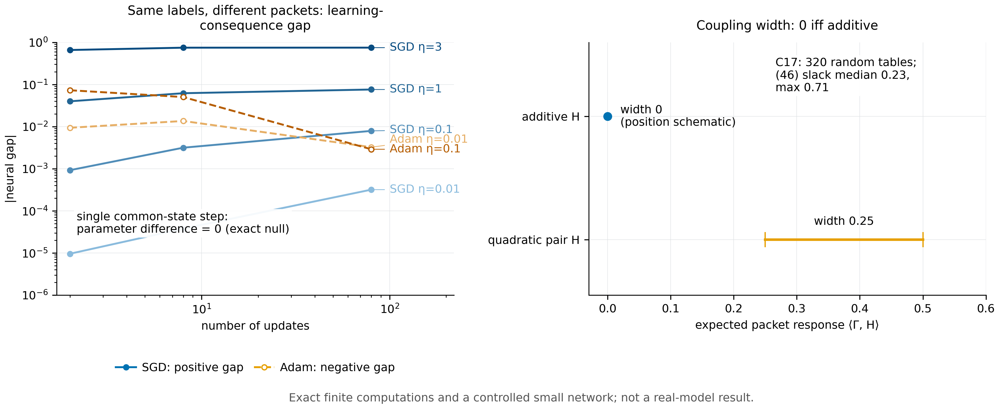

# N16 · Coupling width — Experiments

[← Framework map](../README.md) · [Proof](../proofs/N16_coupling_width.md) · [中文](N16_coupling_width_ZH.md)

**Verdict.** N16 holds. On 320 random packet-response tables (C17; 2,567 assertions; worst residual $`9.9\times10^{-16}`$), three things are confirmed:

- **(a)** the coupling width is exactly zero for additive tables and positive for non-additive ones;
- **(b)** holds, with median slack 0.231;
- **(c)** the restricted-pairing and strict-null statements hold exactly.

The package check gives additive width 0 and quadratic-pair width 0.25, and a strict-null residual of $`2.8\times10^{-17}`$.

In the controlled network ([C23(e)](N16_coupling_width.md#c23e--regrouping-in-a-controlled-network) (the v0.14 controlled-network experiment in which Adam departed from the affine comparator)), one common-state SGD step is exactly regrouping-invariant (residual 0). Sequential updates on the same labels grouped differently give gaps that grow with step size and horizon, from $`10^{-5}`$ to $`0.75`$. This is the non-additive learning-consequence effect that the proposition says can exist only beyond the single-step null.


[PDF](../figures/N16_coupling.pdf)

## C17 · Coupling polytope, additive characterization and strict null

**Why.** [N16(a)–(b)](../proofs/N16_coupling_width.md) has four claims: the "iff" characterization of zero width, inequality [N16(b)](../proofs/N16_coupling_width.md), its failure as an "iff" under forbidden pairings, and the single-step null. Each would fail visibly on a random instance if wrong.

**Setup.**

- $`\lvert\mathcal Y_1\rvert,\lvert\mathcal Y_2\rvert\in[2,5]`$, with strictly positive marginals.
- Random additive tables $`H=a+b`$, and random non-additive tables.
- Seed `SeedSequence([20261010, 17])`.

**Procedure.**

1. Compute the width with two LPs (the max and the min of $`\langle\Gamma,H\rangle`$ over the coupling polytope).
2. Compute $`\inf_{a,b}\lVert H-a-b\rVert_\infty`$ with a third LP and check [N16(b)](../proofs/N16_coupling_width.md).
3. Construct the forbidden-pairing example.
4. Check the null exactly in rationals: one SGD step of a linear model at a common parameter, with the same examples regrouped. Then run two sequential updates with regrouping.

**Result** (`theory/independent_checks/results_independent_v014.json`, `claims[id=C17]`):

| Quantity | Value |
|---|---:|
| status | PASS |
| instances / assertions | 320 / 2,567 |
| worst residual (LP feasibility) | $`9.85\times10^{-16}`$ |
| [N16(b)](../proofs/N16_coupling_width.md) slack: median / max | 0.231 / 0.712 (`details.median_inequality_slack`, `maximum_slack`) |
| forbidden-pairing table with zero feasible width | $`\begin{pmatrix}0&0\cr 0&1\end{pmatrix}`$ (`details.forbidden_pairing_response`) |
| one-step regrouping difference (linear model, exact) | 0 |
| two-step sequential regrouping difference (linear model, exact) | $`1/32`$ (`details.sequential_linear_parameter_gap`) |

**What this shows.**

- Zero width holds exactly for the additive tables.
- [N16(b)](../proofs/N16_coupling_width.md) is a valid but generally strict bound; the typical slack is about a quarter of the return range.
- The single-step null is exact in rational arithmetic, so any measured single-step effect is an implementation artefact.
- Sequential updates create a genuine regrouping effect. This is the $`\eta^2H_{P_2}g_{P_1}`$ term of Part 4 of the proof.

## Package check · Coupling and additive null

**Why.** This is an independent implementation of the same finite statements.

**Result** (`theory/v014_repro/results_v014_rerun.json`, `coupling_and_additive_null`):

| Quantity | Value |
|---|---:|
| width of an additive table | 0.0 |
| quadratic pair: min / max / width | 0.25 / 0.50 / 0.25 |
| strict frozen-gradient additive null, max residual | $`2.8\times10^{-17}`$ |

**What this shows.** The additive table has zero width, the non-additive quadratic pair has positive width, and the frozen-gradient null is exact to machine precision.

## C23(e) · Regrouping in a controlled network

**Why.** The width is defined through actual learning consequences. An actual network trained on the same labels, grouped differently, should show an exactly zero difference at one common-state step, and possibly nonzero differences after sequential updates.

**Setup.**

- Network: one-hot context, 4 tanh units, sigmoid output, float64; label "controlled neural, not Gemma, not an external benchmark".
- Source A packets are $`\lbrace (0,0),(1,1)\rbrace`$ and source B packets are $`\lbrace (0,1),(0,1)\rbrace`$. Both contain the same four labels, so the marginals are identical.
- Optimizers: SGD with $`\eta\in\lbrace 0.01,0.1,1,3\rbrace`$, and Adam ($`\beta=(0.9,0.999)`$, $`\epsilon=10^{-8}`$) with $`\eta\in\lbrace 0.01,0.1\rbrace`$.
- 1, 4 or 40 cycles, giving 2, 8 or 80 updates.
- Exact enumeration of all deterministic histories.

**Procedure.** Compute the final expected-return gap between the two groupings. Separately, compute the parameter difference after one common-state step with identical weights.

**Result** (`theory/independent_checks/results_independent_v014.json`, `controlled_neural.details`):

- `additive_null_parameter_residual` = **0.0** for the single common-state step;
- `gradient_max_residual` = $`8.7\times10^{-11}`$ for the manual gradients against central differences.

Return gap A − B (`regrouping`):

| optimizer | $`\eta`$ | 2 updates | 8 updates | 80 updates |
|---|---:|---:|---:|---:|
| SGD | 0.01 | $`1.0\times10^{-5}`$ | $`3.8\times10^{-5}`$ | $`3.2\times10^{-4}`$ |
| SGD | 0.1 | $`9.2\times10^{-4}`$ | $`3.2\times10^{-3}`$ | $`7.9\times10^{-3}`$ |
| SGD | 1.0 | 0.040 | 0.062 | 0.076 |
| SGD | 3.0 | 0.658 | 0.747 | 0.749 |
| Adam | 0.01 | −0.0094 | −0.0136 | −0.0032 |
| Adam | 0.1 | −0.0729 | −0.0503 | −0.0029 |

**What this shows.** In an actual nonlinear learner the joint organization of identical-marginal feedback changes the learned student. The effect is zero exactly where the proposition says it must be (one common-state step), grows with step size and horizon under SGD, and has a different sign and dynamics under Adam. So the coupling width is a real, optimizer-dependent learning-consequence quantity. Packet organization belongs to the response the method must measure (N17), not to a fixed property of the data.

## Reproduce

```bash
CUDA_VISIBLE_DEVICES='' PYTHONDONTWRITEBYTECODE=1 theory/.venv/bin/python theory/independent_checks/check_v014_independent.py --only C17,C23 --output theory/independent_checks/subset.json
CUDA_VISIBLE_DEVICES='' theory/.venv/bin/python docs/direction/v014_handoff/verify_environment_information_v014.py   # package check
```

## Artifacts

- `theory/independent_checks/results_independent_v014.json`: `claims[id=C17]` and `controlled_neural.details.regrouping`.
- `theory/v014_repro/results_v014_rerun.json`: `coupling_and_additive_null`.
- Figure: `../figures/N16_coupling.pdf` and `.png` (spec `../figures/specs/N16.md`).
