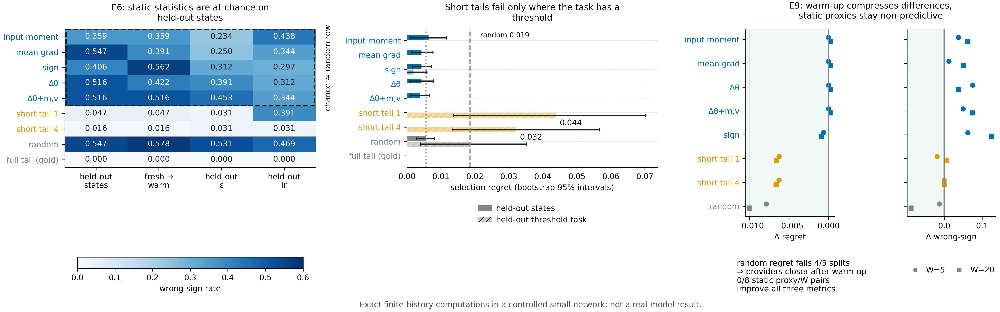

# N17 · Consequence-Calibrated Experience Distillation（CED） — 实验

[← 框架总图](../README_ZH.md) · [推导](../proofs/N17_ced_method_ZH.md)

**结论.** 受控学习者上的实验确立了 CED 设计规则 2–4 背后的事实。

- **(b)** **静态统计量失效（E6）.** 在留出的学习者状态上，静态更新统计量预测不了完整尾部 response 的符号。输入矩误差、平均梯度、符号模式、$`\Delta\theta`$ 以及带 $`(m,v)`$ 的 $`\Delta\theta`$，在 36–55% 的 provider 上给出错误符号；随机打分是 55%。它们与 gold 对比的 Spearman 相关最多 0.10。所以选择必须用实测 response（规则 2）。
- **(b)** **实测短尾部有效，但有一个限度（E6）.** 4 步尾部在每种状态、$`\epsilon`$、学习率和暖度偏移下，错误符号率为 1.6–3.1%，选择 regret 为零。在留出的阈值任务上，两种短尾部都选得比随机还差：regret 为 0.044（1 步）和 0.032（4 步），随机为 0.019。完整尾部是唯一在每个划分上 regret 和错误符号率都为零的测量。所以尾部长度本身是被估计量的一部分。
- **(c)** **warm-up 改变的是哪个统计量起作用，而不是静态统计量够不够（E9）.** lr = 0 的 moment warm-up 压缩了 provider 之间的差异：随机选择的 regret 在 5 个留出划分中的 4 个上下降，平均降幅在 W = 5 时为 0.0079，在 W = 20 时为 0.0100。但它没有让静态统计量变得有预测力。8 个"静态 proxy × W"组合中，没有一个能同时改善 regret、错误符号率和 Spearman，它们的错误符号率反而上升了 1–8 个百分点。这与规则 3 一致。

所有结果都是受控小网络中的精确有限历史计算，pilot 拟合冻结、划分预先登记。它们不是真实模型或 benchmark 上的结果。


[PDF](../figures/N17_selection.pdf)

## E6 · 用冻结 proxy 做留出的 provider 选择

**动机.** 规则 2 说，provider 必须按它实际的"更新加尾部" response 来评判。E6 检验：当学习者状态、任务、配方或优化器暖度发生变化时，更便宜的统计量能否替代这个 response。每一种变化都是一个单独的留出划分。

**设置**（`theory/v015_checks/proxy_split_freeze.json`，SHA-256 `ac8f4aee…`，在任何留出测量之前写入）：

- **学习者.** [C23](N11_adam_cold_start_ZH.md)（v0.14 受控网络实验，其中 Adam 偏离仿射对照） 网络（one-hot 上下文、4 个 tanh 单元、sigmoid、平均交叉熵、float64）。
  - 状态：`fresh`、`warm2`、`warm5`、`warm9`（都是含 Adam 矩的完整状态）。
  - 配方：8 种，即 Adam（$`\eta\in\lbrace 0.01,0.1\rbrace`$）与 SGD（$`\eta\in\lbrace 0.1,1\rbrace`$），各配 $`\epsilon\in\lbrace 10^{-8},10^{-3}\rbrace`$。
- **Provider.** 定义在 10 个双标签 packet 上的 9 个标签律：`reference_even`、矩匹配的 `moment3_P`/`moment3_Q`、符号匹配的 `low_sign_A`/`B` 与 `high_sign_A`/`B`、`odd_parity` 和 `middle_mixture`。
- **Gold.** 一次候选边界之后接 7 次 IID 参照更新（共 8 次更新），对所有有限历史精确枚举。其值是相对于参照 provider 的对比。
- **Proxy**：只在 pilot 上用 ridge 回归拟合，并冻结在 `proxy_models_frozen.json` 中：
  - 静态：输入矩误差、平均梯度、仅符号、第一步 $`\Delta\theta`$，以及带 $`(m,v)`$ 的 $`\Delta\theta`$；
  - 实测短尾部 response：1 步之后和 4 步之后；
  - 对照：随机打分、任务身份、训练步数。
- **Pilot.** 状态 `fresh` 与 `warm2`，任务 `moment` 与 `parity`，配方 0 与 4；共 72 行。
- **留出划分.**
  - 状态 `warm5`/`warm9`；
  - 任务 `threshold`；
  - 只变 $`\epsilon`$（配方 1、5）；
  - 只变学习率（2、6）；
  - 两者都变（3、7）；
  - 只用 fresh 拟合、在 warm 状态上评估，以及反过来。
  - 合计 432 行留出数据，种子 `SeedSequence([150150, 106])`。
- **指标.**
  - *选择 regret*：最优 provider 的 gold 值减去 proxy 所选 provider 的 gold 值，在 cell 上取平均。
  - *错误符号率*：gold 非零的 provider 中，预测对比与 gold 符号相反的比例。
  - *Spearman*：预测对比与 gold 对比的秩相关。

**做法.** 先把划分清单和冻结的 proxy 系数写盘，然后对每个留出划分评估一次。任何留出结果都不会改动 proxy、其特征、ridge 惩罚或弃权阈值。

**结果**（`theory/v015_checks/results_v015_independent.json`，`groups[id=E6].data.reports.<split>.metrics.<proxy>`）：

*错误符号率*（越低越好）：

|划分|输入矩|平均梯度|符号|Δθ|Δθ+m,v|短尾部 1|短尾部 4|随机|完整尾部|
|---|---:|---:|---:|---:|---:|---:|---:|---:|---:|
|`held_out_states`|0.359|0.547|0.406|0.516|0.516|0.047|0.016|0.547|0.000|
|`held_out_epsilon`|0.234|0.250|0.312|0.391|0.453|0.031|0.031|0.531|0.000|
|`held_out_lr`|0.438|0.344|0.297|0.312|0.344|0.391|0.031|0.469|0.000|
|`held_out_epsilon_lr`|0.438|0.344|0.297|0.312|0.344|0.391|0.031|0.562|0.000|
|`fresh_to_warm`|0.359|0.391|0.562|0.422|0.516|0.047|0.016|0.578|0.000|
|`warm_to_fresh`|0.125|0.125|0.188|0.250|0.438|0.062|0.031|0.469|0.000|
|`held_out_task`|0.250|0.250|0.083|0.250|0.083|0.000|0.042|0.458|0.000|

*选择 regret*（越低越好）：

|划分|输入矩|平均梯度|符号|Δθ|Δθ+m,v|短尾部 1|短尾部 4|随机|完整尾部|
|---|---:|---:|---:|---:|---:|---:|---:|---:|---:|
|`held_out_states`|0.0064|0.0043|0.0043|0.0043|0.0039|0.0000|0.0000|0.0056|0.0000|
|`held_out_epsilon`|0.0013|0.0013|0.0022|0.0013|0.0013|0.0000|0.0000|0.0067|0.0000|
|`held_out_lr`|0.0041|0.0041|0.0070|0.0041|0.0041|0.0007|0.0000|0.0105|0.0000|
|`held_out_epsilon_lr`|0.0040|0.0040|0.0070|0.0040|0.0040|0.0007|0.0000|0.0093|0.0000|
|`fresh_to_warm`|0.0064|0.0064|0.0054|0.0064|0.0064|0.0000|0.0000|0.0045|0.0000|
|`warm_to_fresh`|0.0000|0.0000|0.0012|0.0000|0.0000|0.0000|0.0000|0.0056|0.0000|
|`held_out_task`|0.0000|0.0000|0.0020|0.0000|0.0000|0.0439|0.0322|0.0186|0.0000|

*Spearman*（越高越好；— 表示预测为常数，无定义）：

|划分|输入矩|平均梯度|符号|Δθ|Δθ+m,v|短尾部 1|短尾部 4|随机|完整尾部|
|---|---:|---:|---:|---:|---:|---:|---:|---:|---:|
|`held_out_states`|-0.00|0.05|0.10|0.07|0.07|0.95|0.99|-0.04|1.00|
|`held_out_epsilon`|0.45|0.40|0.45|0.42|0.41|0.96|0.99|-0.07|1.00|
|`held_out_lr`|0.38|0.40|0.46|0.57|0.58|0.34|0.95|0.03|1.00|
|`held_out_epsilon_lr`|0.38|0.40|0.46|0.58|0.58|0.33|0.95|0.04|1.00|
|`fresh_to_warm`|-0.00|-0.07|-0.07|-0.06|-0.09|0.95|0.99|-0.07|1.00|
|`warm_to_fresh`|0.79|0.58|0.73|0.72|0.59|0.90|0.97|0.10|1.00|
|`held_out_task`|0.63|0.58|0.73|0.71|0.84|—|0.54|-0.05|1.00|

**说明了什么.**

1. *静态统计量不是 response.* 在留出的学习者状态上，以及从 fresh 转到 warm 状态时，静态 proxy 处于随机水平：
   - 错误符号率为 0.36–0.56，随机为 0.55–0.58；
   - Spearman 最多 0.10。

   这是 N04 和 N11–N12 在受控学习者上的体现：同一个更新统计量，在不同的完整状态上对应不同的学习后果。
2. *实测 response 是.* 4 步短尾部在每种状态、$`\epsilon`$、学习率和暖度偏移下，错误符号率都不超过 3.1%，regret 为 0。1 步尾部在学习率偏移下会变差（错误符号率 0.39），但仍能近乎最优地选择（regret 0.0007）。
3. *尾部长度是被估计量的一部分.* 在留出的 `threshold` 任务上，短尾部选得比随机还差：regret 0.044 和 0.032，随机为 0.019。它们给出的排序与 8 步完整尾部不同；完整尾部是唯一在每个划分上 regret 和错误符号率都为零的测量。静态 proxy 在这个划分上恰好 regret 为零，但错误符号率有 8–25%，在留出状态上又处于随机水平，所以它们不能跨划分迁移。
4. *量级.* regret 在回报单位上是 $`10^{-3}`$–$`10^{-2}`$ 量级，每个划分的面板有 8 个 cell。cell bootstrap（`regret_bootstrap95`）描述的是这个有限面板上的变化，不是总体置信区间。

## E9 · lr = 0 moment warm-up 下的 proxy 迁移

**动机.** N12 表明，温热的优化器状态会改变 provider 必须匹配的一阶统计量。E9 问的是：把矩预热之后，E6 中失效的静态统计量是否会变得有预测力。

**设置**（`theory/v015_checks/proxy_split_freeze_E9.json`，SHA-256 `f895853d…`；模型 `proxy_models_frozen_E9.json`，SHA-256 `c96065f0…`；两者都在任何新的留出面板之前写入）：

- **分组.** `fresh`、`fresh_W5` 与 `fresh_W20`。warm 组在 `reference_even` 的一个声明好的 IID 前缀上，以学习率恰为 0 跑 $`W\in\lbrace 5,20\rbrace`$ 步 Adam（$`\beta=(0.9,0.999)`$）。参数不变，只有 $`m`$、$`v`$ 和 $`t`$ 前进。
- **拟合.** E6 的 provider 菜单、特征、gold、ridge 拟合和指标都不变。只用原来冻结的 E6 pilot 做拟合，并核验系数完全一致。只变状态的对比沿用原来只用 warm2 的拟合。
- **划分.** 五个配对的 冷/暖 划分：留出状态、任务（`threshold`）、$`\epsilon`$、学习率、两者都变；合计 918 行留出数据。随机对照在各组之间配对。
- **种子.** `SeedSequence([150150, 109])`。

**做法.** 对每个划分、proxy 和 $`W`$，计算每个指标的"暖减冷"差值，并按划分等权平均。改善指 regret 更低、错误符号率更低、Spearman 更高。

**结果**（`groups[id=E9].data.summary` 与 `cheap_proxy_results`；表中为 5 个划分上"暖 − 冷"的平均差值，括号内为改善的划分数）：

|proxy|W|Δ regret|Δ 错误符号率|Δ Spearman|三项同时改善|
|---|---:|---|---|---|---|
|输入矩|5|+0.00000 (0/5)|+0.0375 (1/5)|−0.030 (0/5)|否|
|输入矩|20|+0.00021 (0/5)|+0.0625 (0/5)|−0.207 (0/5)|否|
|平均梯度|5|+0.00000 (0/5)|+0.0125 (1/5)|+0.042 (4/5)|否|
|平均梯度|20|+0.00021 (0/5)|+0.0500 (0/5)|−0.150 (0/5)|否|
|Δθ|5|+0.00000 (0/5)|+0.0750 (0/5)|−0.082 (2/5)|否|
|Δθ|20|+0.00021 (0/5)|+0.0375 (0/5)|−0.200 (0/5)|否|
|Δθ+m,v|5|+0.00000 (0/5)|+0.0500 (1/5)|−0.072 (2/5)|否|
|Δθ+m,v|20|+0.00021 (0/5)|+0.0750 (0/5)|−0.191 (0/5)|否|
|仅符号|5|−0.00062 (3/5)|+0.0625 (0/5)|−0.052 (0/5)|否|
|仅符号|20|−0.00090 (4/5)|+0.1250 (0/5)|−0.270 (0/5)|否|
|短尾部 1|5|−0.00625 (1/5)|−0.0187 (2/5)|+0.053 (4/5)|是|
|短尾部 1|20|−0.00662 (1/5)|+0.0063 (2/5)|−0.152 (2/5)|否|
|短尾部 4|5|−0.00626 (3/5)|+0.0000 (2/5)|−0.028 (2/5)|否|
|短尾部 4|20|−0.00662 (3/5)|+0.0000 (2/5)|+0.039 (5/5)|否|
|随机|5|−0.00785 (4/5)|−0.0125 (2/5)|−0.024 (2/5)|否|
|随机|20|−0.00996 (4/5)|−0.0875 (3/5)|+0.048 (3/5)|是|

各划分上随机选择的 regret，冷 → W=5 / W=20（`comparisons[proxy=random]`）：

| 划分 | 冷 | W=5 | W=20 |
|---|---:|---:|---:|
| 留出状态 | 0.0067 | 0.0042 | 0.0034 |
| 留出任务（`threshold`） | 0.0430 | 0.0098 | 0.0039 |
| 留出 $`\epsilon`$ | 0.0076 | 0.0042 | 0.0035 |
| 留出学习率 | 0.0089 | 0.0086 | 0.0054 |
| 留出 $`\epsilon`$ + 学习率 | 0.0048 | 0.0049 | 0.0049 |

**说明了什么.**

1. *warm-up 压缩了 provider 之间的差异.* 均匀随机选择的 regret 衡量的是菜单上 gold 对比的离散程度，它在 5 个划分中的 4 个上下降，降幅最大的是阈值任务，从 0.043 降到 0.004。warm-up 之后，可供挑选的差别变小了。这与 [N12(W1)](../proofs/N12_optimizer_warmth_ZH.md)–[N12(W3)](../proofs/N12_optimizer_warmth_ZH.md) 一致：在温热状态上，response 取决于平均的预条件化梯度，所以主要在符号结构上不同的 provider 彼此靠得更近。
2. *warm-up 不会让静态统计量变得有预测力.* 对四个静态 proxy，regret 在任何划分上都没有改善，错误符号率上升 1–8 个百分点，$`W=20`$ 时 Spearman 下降 0.15–0.21。同时改善三项指标的"proxy × W"组合数为 0/8。仅符号特征在 regret 上略有改善，但符号准确率损失 6–13 个百分点。
3. *对方法的含义.* 按规则 3，暖度决定的是*哪一个*统计量携带信息，而这里用到的静态 proxy 在两种状态下都不是那个统计量。response 仍然必须实测，而且要在记录了暖度的状态上测。

## 复现

```bash
CUDA_VISIBLE_DEVICES='' theory/.venv/bin/python theory/v015_checks/check_v015.py --only E6,E9 --output theory/v015_checks/quick/n17.json
```

## 产物

- `theory/v015_checks/results_v015_independent.json`：`groups[id=E6]`（`reports`、`negative_results`、`sign_pair_audit`）与 `groups[id=E9]`（`summary`、`cheap_proxy_results`、`comparisons`、`freeze_events`）。
- 冻结的约定文件：`theory/v015_checks/proxy_split_freeze.json`、`proxy_models_frozen.json`、`proxy_split_freeze_E9.json` 与 `proxy_models_frozen_E9.json`。
- 规格：`theory/v015_checks/SPEC.md`（E6）与 `theory/v015_checks/README.md`（E9 的方法）。
- 图：`../figures/N17_selection.pdf` 与 `.png`（规格见 `../figures/specs/N17.md`）。
