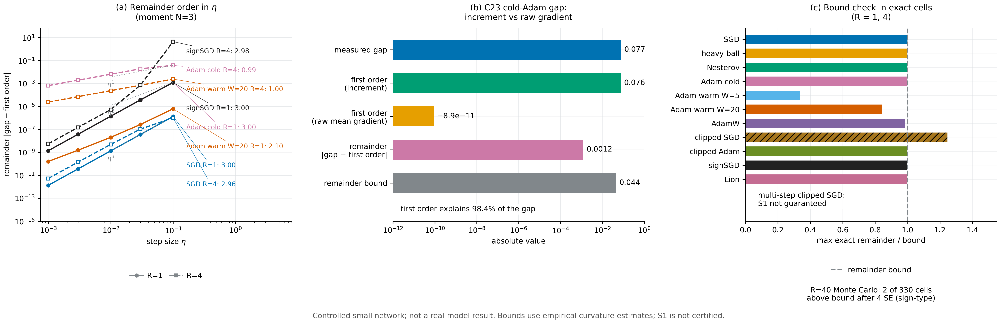

# N18 · Optimizer-transformed linear response — Experiments

[← Framework map](../README.md) · [Proof](../proofs/N18_optimizer_transformed_response.md) · [中文](N18_optimizer_transformed_response_ZH.md)

**Verdict.** N18 holds. Check V8 confirms Theorems C1 and C3 in exact arithmetic on 3,712 instances with zero residual:

- the order-$k$ expansion with $k=\deg V$ equals the exact gap on all 140 random polynomial continuations;
- every truncated remainder respects its bound (worst remainder/bound 0.275);
- a smooth logistic continuation stays at or below 0.183 of its certified bound;
- the first-order statistic count $d_0^{(1)}$ never exceeds $\min\lbrace\dim U,m-1\rbrace$ on 160 panels, and dropping one statistic always admits a feature-matched pair whose first-order term differs (158 LP witnesses).

Check E10 confirms Theorem C2 in a real controlled network for eleven optimizer configurations:

- **Bound.** In every exact-history cell where S$_1$ holds, the gap minus the first-order term stays within the remainder bound. The largest ratio for each smooth optimizer is at most 0.9986.
- **C23 Adam gap explained.** The first-order term over the complete state predicts the C23 cold-Adam gap: $0.07568$ against a measured $0.07691$, while the raw mean-gradient term is $-8.9\times10^{-11}$.
- **Orders.** The remainder is second order in $\eta$ at $R=1$ for every optimizer and at $R=4$ for SGD, momentum, clipped SGD and sign optimizers. When two gradient moments are matched, SGD's remainder is third order (slope 3), as the moment hierarchy C1′ predicts.
- **Adam over several rounds.** For Adam-type optimizers at $R=4$ the remainder is first order in $\eta$ (slope about 1), which is the second-moment block identified in Remark 3 of the proof.

The one exact cell above its bound is multi-step clipped SGD (ratio 1.245); its continuation has clip kinks, so S$_1$ is not guaranteed there. Two Monte Carlo cells at $R=40$ remain above the bound after four standard errors; both are sign-type optimizers. These cells mark the boundary of the smoothness assumption.



[PDF](../figures/N18_linear_response.pdf)

## V8 · Exact finite checks of C1 and C3

**Why.** C1 is a Taylor identity integrated against two laws. An error in bookkeeping the tensor moments, the cancellation of $V(x)$ or the remainder constant would show up as an instance whose gap differs from the truncated expansion by more than the bound. C3 claims that the projected mean increment is the exact minimal first-order statistic. A wrong count would show up either as a feature-matched pair with a nonzero first-order term at the claimed dimension, or as an unnecessary statistic.

**Setup.**

- *Polynomials.* $D=2,\dots,5$ and 35 replicates per $D$, with degree cycling through $1,\dots,4$. Coefficients lie in $\lbrace -1,-2/3,\dots,1\rbrace $, with a unit leading monomial. Each instance has a random rational state $x$, six rational increments and two random laws $P,Q$ on them. Everything is exact `Fraction` arithmetic.
- *Remainder constants.* $M_{k+1}$ comes from a coefficient-sum majorant on the box containing $x$ and $x+\Delta$ (`data.box_rule`). This is a rational upper bound, not a fitted constant.
- *Logistic.* $V=\sigma(q)$ with $q(z)=\tfrac12z^\top Az+b^\top z$ on $\mathbb R^3$, six increments and random laws. The Hessian certificate is $M_2=L^2/(6\sqrt3)+\lVert A\rVert_{\rm op}/4$ with $L=\max_{\rm vertices}\lVert Az+b\rVert_2$ (`data.logistic.certificate`). 2,200 random instances, plus 12 restarts × 100 hill-climbing steps.
- *Ranks.* 160 panels with alphabet size $m\in\lbrace 4,\dots,9\rbrace $, increment dimension $D\in\lbrace 2,\dots,5\rbrace $, random integer increments $D(y)$ and random gradient directions spanning $U$. Ranks are exact (SymPy); witnesses are found by LP (HiGHS).
- Seed `SeedSequence([150150, 8])`.

**Procedure.**

1. For each polynomial, compute the exact gap and the order-$j$ terms $\langle\nabla^jV(x),\mathbb E_P\Delta^{\otimes j}-\mathbb E_Q\Delta^{\otimes j}\rangle/j!$. Assert that their sum equals the gap when $k=\deg V$, and that the remainder is within the bound for every $k<\deg V$.
2. For the logistic family, assert $\lvert\text{gap}-\text{first order}\rvert\le\tfrac{M_2}2(m_2^P+m_2^Q)$, then maximize the ratio adversarially.
3. For each rank panel:
   - compute $d_0^{(1)}=\operatorname{rank}[\mathbf 1,\mathcal G^{(1)}]-1$ and check it against the centered rank;
   - assert $d_0^{(1)}\le\min\lbrace\dim U,m-1\rbrace$;
   - check that a perturbation in the null space of the retained statistics has zero $U$-projection and leaves every first-order term unchanged;
   - with only $d_0^{(1)}-1$ statistics retained, solve an LP for a feature-matched pair $P,Q$ and assert that some first-order term differs.

**Result** (`theory/v015_checks/results_v015_independent.json`, `groups[id=V8]`):

| Quantity | Value | Key |
|---|---:|---|
| status / instances / assertions / worst residual | PASS / 3,712 / 4,978 / 0 | `status`, `n_instances`, `n_assertions`, `worst_residual` |
| polynomials with exact order-$\deg V$ expansion | 140 / 140 | `data.polynomials[*].gap`, `[*].expansion` |
| truncated remainders within bound | 344 / 344; largest remainder/bound 0.275 | `data.polynomials[*].bounds` |
| logistic: largest $\lvert$gap − first order$\rvert$ / bound | 0.183 (gap −0.0231, first order −0.2307, bound 1.137, $M_2=0.823$) | `data.logistic.best` |
| rank panels with $d_0^{(1)}\le\min\lbrace\dim U,m-1\rbrace$ | 160 / 160 | `data.ranks[*].d0`, `[*].dim_U` |
| panels with an LP witness at $d_0^{(1)}-1$ statistics | 158 (the other 2 have $d_0^{(1)}=0$); smallest separating objective 0.113 | `data.ranks[*].LP_witness` |

**What this shows.** The expansion of C1 is exact in finite arithmetic, and its remainder bound holds with room to spare for a smooth non-polynomial continuation. The count of C3 is exact: $d_0^{(1)}$ statistics suffice, and one fewer always leaves a pair of laws that agree on every retained statistic yet differ at first order.

## E10 · The run-level representation in a controlled network, across optimizers

**Why.** C2 claims that, over a whole run, the gap between two feedback laws equals the summed first-order term over the complete state plus a remainder bounded by the curvature constants. Three things could break in a real network: the first-order term could miss the gap, the remainder could exceed its bound, or the remainder could fail to shrink as $\eta\to0$. E10 measures all three, and compares against the naive first-order term that uses the raw mean gradient.

**Setup.**

- *Network.* The C23 network: one-hot context, 4 tanh units, sigmoid, mean cross-entropy, float64. Controlled neural, not Gemma.
- *Laws.* Moment $N=2,3,4$ and parity $N=2,3$ (the C23 laws, which match label moments below order $N$), plus the clipped-mean witness realized on a linear-logit model.
- *Optimizers (11).* SGD; heavy-ball ($\beta=0.9$); Nesterov ($\beta=0.9$); Adam cold ($\beta=(0.9,0.999)$, $\epsilon=10^{-8}$, bias correction); Adam warm after $W=5$ and $W=20$ lr$=0$ moment warm-up steps; AdamW ($\lambda=0.01$); clipped SGD; clipped Adam; signSGD; Lion ($\beta_1=0.9$, $\beta_2=0.99$).
- *Clip threshold.* Chosen per task closest to 50% clipped mass. Where gradient norms tie, the 30–70% band is not attainable (moment $N=3$, parity $N=3$: 25%). This is recorded in `data.design[*].clip_active_probability`.
- *Grid.* $\eta\in\lbrace 10^{-3},3\cdot10^{-3},10^{-2},3\cdot10^{-2},10^{-1}\rbrace $ and $R\in\lbrace 1,4,40\rbrace $: 990 cells in all.
- Seed `SeedSequence([150150, 110])`.

**Procedure.** For each cell:

1. Compute the exact gap $L(P)-L(Q)$ by complete history enumeration for $R=1,4$, and by independent runs with standard errors for $R=40$.
2. Compute the C2 first-order term $\sum_t\mathbb E_{d_t^Q}\langle\nabla V^P_{t+1}(X_t),\mu^P_t-\mu^Q_t\rangle$ over the complete state $(\theta,m,v)$. $\nabla V^P$ comes from Richardson-extrapolated central differences of the exactly enumerated $P$-continuation, with the differentiation error recorded.
3. Compute the naive term, which uses the raw mean gradient as if the optimizer were SGD preconditioned by the current Adam denominator.
4. Estimate $M_2$ by sampled and hill-climbed segment curvature, never padded after a gap is observed, and evaluate the remainder bound.
5. Record the ratio $\lvert$gap − first order$\rvert$/bound and the log–log slopes in $\eta$.

**Result 1 — the bound in the exact cells** (`groups[id=E10].data.optimizer_summary`, `data.cells`):

| Optimizer | exact cells | largest exact ratio | exact cells above bound |
|---|---:|---:|---:|
| SGD | 60 | 0.9986 | 0 |
| heavy-ball | 60 | 0.9984 | 0 |
| Nesterov | 60 | 0.9980 | 0 |
| Adam cold | 60 | 0.9981 | 0 |
| Adam warm, $W=5$ | 60 | 0.3339 | 0 |
| Adam warm, $W=20$ | 60 | 0.8432 | 0 |
| AdamW | 60 | 0.9817 | 0 |
| clipped Adam | 55 finite (5 with nonfinite derivatives) | 0.9982 | 0 |
| signSGD | 60 | 0.9981 | 0 |
| Lion | 60 | 0.9981 | 0 |
| clipped SGD | 60 | 1.2453 | 1 (multi-step kink) |

**Result 2 — the C23 Adam gap is a first-order effect of the optimizer increment** (`data.C23_prediction`; moment $N=3$, $\eta=0.1$, $R=1$):

| Quantity | Value |
|---|---:|
| measured gap $L(P)-L(Q)$ | 0.076907 |
| C2 first-order term (complete-state increment) | 0.075683 |
| naive first-order term (raw mean gradient) | $-8.87\times10^{-11}$ |
| remainder $\lvert$gap − first order$\rvert$ | 0.001225 |
| remainder bound ($\hat M_2=0.342$) | 0.04447 |

The two label laws have equal means, so every mean-gradient statistic is blind to them. The cold-Adam increment $-\eta h_\epsilon(G)$ is not, and its first-order term accounts for 98.4% of the gap. At the same cell, signSGD and Lion give the same gap and first-order term (0.07691 and 0.07568), because their first step is the same sign map. Clipped SGD gives 0.00303 for both quantities, while its raw mean-gradient term is 0 (`data.cells`).

**Result 3 — orders of the remainder** (log–log slope of $\lvert$gap − first order$\rvert$ in $\eta$, per task; `data.optimizer_summary[*].slopes`; cells whose remainder sits at the numerical floor have no slope):

| Optimizer | $R=1$ | $R=4$ |
|---|---|---|
| SGD, heavy-ball, Nesterov | 1.98–2.0 at $N=2$ and the clipped witness; 3.0 at moment/parity $N=3$ | 1.95–1.99 at $N=2$ and the clipped witness; 2.91–2.99 at $N=3$; Nesterov 3.98 at moment $N=4$ |
| clipped SGD, signSGD, Lion | 2.0; 3.0 at $N=3$ | 2.0–2.09; 2.71–3.01 at $N=3$ |
| Adam cold | 2.0–3.0 | 0.99 (moment $N=3$), 1.0 (clipped witness); 1.96–2.98 on the other tasks |
| AdamW | 2.0–3.0 | 0.99 (moment $N=3$), 1.31 (moment $N=4$), 1.0 (clipped witness); 1.98–2.98 on the other tasks |
| clipped Adam | 2.0–3.0 | 0.91 (moment $N=3$), 1.04 (clipped witness); 2.0–2.93 on the other tasks |
| Adam warm, $W=5$ | 1.99–2.98 | 1.11–1.17 (moment $N=2,3,4$), 1.0 (clipped witness); 2.03 and 2.92 (parity) |
| Adam warm, $W=20$ | 2.0–3.0 | 1.0 (moment $N=3$), 1.16 (moment $N=4$), 1.0 (clipped witness); 3.04 (moment $N=2$), 1.99 and 3.0 (parity) |

**Result 4 — how much of the multi-round Adam gap is first order** (moment $N=3$, $R=4$; `data.cells`):

| Optimizer | $\eta=10^{-3}$: gap / first order | $\eta=10^{-1}$: gap / first order | absolute remainder at $\eta=10^{-3}$ |
|---|---|---|---:|
| Adam cold | $1.90\times10^{-3}$ / $1.24\times10^{-3}$ | 0.1196 / 0.0810 | $6.6\times10^{-4}$ |
| Adam warm, $W=5$ | $4.38\times10^{-4}$ / $2.22\times10^{-4}$ | 0.0663 / 0.0365 | $2.2\times10^{-4}$ |
| Adam warm, $W=20$ | $4.44\times10^{-5}$ / $2.01\times10^{-5}$ | 0.0044 / 0.0020 | $2.4\times10^{-5}$ |
| clipped SGD | $1.21\times10^{-4}$ / $1.21\times10^{-4}$ | 0.0115 / 0.0115 | $2.2\times10^{-11}$ |

**Result 5 — boundary of the smoothness assumption.**

| Where | What happens | Key |
|---|---|---|
| clipped SGD, clipped witness, $\eta=0.1$, $R=4$ | the only exact cell above its bound: ratio 1.245 (gap 0.04476, first order 0.04637, bound 0.00129). Later clipping decisions make the continuation nonsmooth, so S$_1$ is not guaranteed. | `data.cells` |
| $R=40$ (330 Monte Carlo cells) | 25 cells above the point bound before standard errors; 2 remain after four SE, both sign-type (signSGD moment $N=4$, $\eta=0.01$; Lion clipped witness, $\eta=10^{-3}$) | `[*].excess_over_bound_after_four_SE` |
| clipped Adam, moment $N=4$ | 10 cells with nonfinite central differences at cold zero-gradient coordinates, recorded as unavailable | `[*].bound_status` |

**What this shows.**

- In a real network, the gap between two feedback laws is the first-order term of the *optimizer increment* plus a remainder within its curvature bound, wherever the continuation is smooth.
- The increment is the right statistic. For the C23 laws the raw mean gradient predicts nothing, while the increment predicts 98% of the cold-Adam gap.
- The remainder is $O(\eta^2)$ for SGD, momentum, clipping and sign optimizers, and $O(\eta^3)$ when two increment moments agree, which is the moment hierarchy C1′.
- For Adam-type optimizers over several rounds, the second-moment block makes the remainder first order in $\eta$. The first-order term then carries 45–68% of the gap on the moment task, and the absolute remainder falls 27-fold from the cold state to $W=20$ warm-up steps. This is the regime where node [N20](N20_first_order_audit.md) requires the margin condition before a first-order ranking can be trusted.
- The cells above their bounds all lie outside the theorem's smoothness hypothesis: multi-step clipped SGD, and Monte Carlo cells of sign optimizers.

## Reproduce

```bash
CUDA_VISIBLE_DEVICES='' theory/.venv/bin/python theory/v015_checks/check_v015.py --only V8,E10 --output theory/v015_checks/quick/n18.json
```

## Artifacts

- `theory/v015_checks/results_v015_independent.json`: `groups[id=V8]` and `groups[id=E10]`. E10 per-cell records are in `data.cells`, summaries in `data.optimizer_summary`, the C23 cell in `data.C23_prediction`, and the design in `data.design`.
- Code: `theory/v015_checks/otlr.py` (`check_V8`, `check_E10`); specification in `theory/v015_checks/README.md`.
- Suite figures: `theory/v015_checks/figs/E10.png` and `.svg`.
- Figure: `../figures/N18_linear_response.pdf` and `.png` (spec `../figures/specs/N18.md`).
