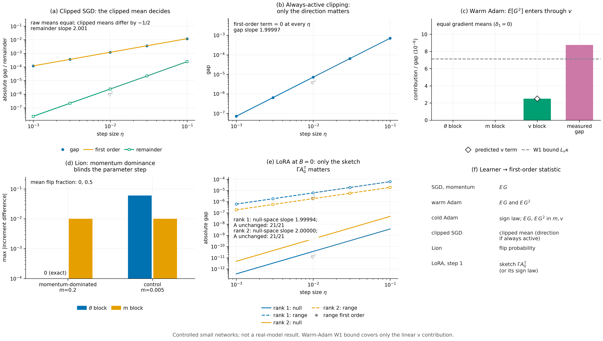

# N19 · What each learner makes the feedback carry — Experiments

[← Framework map](../README.md) · [Proof](../proofs/N19_learner_statistics.md) · [中文](N19_learner_statistics_ZH.md)

**Verdict.** N19 holds. Check E11 passes its five catalog witnesses with 105 assertions; the worst residual is $8.0\times10^{-21}$. Each witness confirms one row of Theorem C4.

- **Clipped mean, C4(e).** Two gradient laws with equal raw means but different clipped means separate at first order. The predicted first-order gap $\tfrac\eta2\sigma'(0.4)$ matches the measured gap with a remainder of slope 2.001.
- **Always-active clipping, C4(e).** When the mean unit directions agree, the first-order term is exactly 0 and the gap is second order (slope 1.99997).
- **Warm Adam, C4(c).** With equal gradient means, the parameter and $m$ blocks contribute exactly 0. The $v$ block contributes $(1-\beta_2)\langle\nabla_vV,\delta_2\rangle=2.504\times10^{-6}$, as predicted to $10^{-12}$. Equal-mean laws are therefore not first-order equivalent for warm Adam.
- **Lion, C4(f).** When momentum dominates, the parameter-block contrast between two very different gradient laws is exactly 0, with no sign flips. The $m$ block carries exactly $0.01\,\delta_1$.
- **LoRA, C4(g).** At $B=0$, $A$ is bitwise unchanged after the first step under SGD, heavy-ball and cold Adam for every law. Laws differing only in the null space of $A_0^\top$ have first-order gap below $10^{-20}$ and a second-order gap (slope 2.000). Laws differing in the range have a first-order gap that matches the measured gap to within 0.3% at every $\eta$, and to within $3\times10^{-5}$ relative at $\eta=10^{-3}$.

The cold-Adam row, C4(d), is confirmed in node [N18](N18_optimizer_transformed_response.md), check E10. On the C23 laws, which have equal means, the cold-Adam first-order term $-\eta\langle\nabla_\theta V,\mathbb E_Ph_\epsilon-\mathbb E_Qh_\epsilon\rangle=0.07568$ accounts for the measured gap $0.07691$. The raw mean-gradient term is $-8.9\times10^{-11}$.



[PDF](../figures/N19_learner_statistics.pdf)

## E11(a) · Clipped SGD: the statistic is the clipped mean

**Why.** C4(e) says that under clipping the feedback must match $\mathbb E\operatorname{clip}_c(G)$, not $\mathbb E\,G$. If clipping changed only magnitudes, two laws with equal raw means would agree at first order. A first-order gap at equal raw means confirms the clipped mean as the statistic.

**Setup.**

- A direct gradient-law experiment on a sigmoid with linear logit at $\theta=0.4$.
- $P(G=4)=\tfrac14$, $P(G=-\tfrac43)=\tfrac34$ and $Q=\delta_0$; clip at $c=1$; clipped SGD.
- $\eta\in\lbrace 10^{-3},3\cdot10^{-3},10^{-2},3\cdot10^{-2},10^{-1}\rbrace $.

The gradients $4$ and $-4/3$ cannot occur in the fixed C23 network at its initialization, so a linear-logit model realizes them (`groups[id=E11].notes`).

**Procedure.** Assert that the raw means agree and the clipped means differ by $-\tfrac12$. Compute the exact gap $(P-Q)\sigma(\theta+\Delta\theta)$ and the predicted first-order gap $\eta\,\sigma'(0.4)/2$. Assert the analytic second-order bound $\lvert$gap − first order$\rvert\le\eta^2/(12\sqrt3)$.

**Result** (`groups[id=E11].data.clipped_mean`):

| $\eta$ | measured gap | first-order prediction | remainder |
|---:|---:|---:|---:|
| 0.001 | $1.20107\times10^{-4}$ | $1.20130\times10^{-4}$ | $2.37\times10^{-8}$ |
| 0.01 | $1.19892\times10^{-3}$ | $1.20130\times10^{-3}$ | $2.38\times10^{-6}$ |
| 0.1 | $1.17675\times10^{-2}$ | $1.20130\times10^{-2}$ | $2.46\times10^{-4}$ |

The log–log slope of the remainder is 2.0015 (`remainder_slope`).

**What this shows.** The raw mean gradient predicts a zero gap; the clipped mean predicts the measured gap to first order, with an $O(\eta^2)$ remainder.

## E11(b) · Always-active clipping: only the direction matters

**Why.** When every gradient is clipped, C4(e) reduces the statistic to the mean unit direction $c\,\mathbb E[G/\lVert G\rVert]$. Two laws with the same mean direction must then agree at first order, whatever their magnitudes.

**Setup.** Two-dimensional gradients with $\lVert G\rVert\ge2>c=1$: $P$ uniform on $\lbrace(\pm2,0)\rbrace$ and $Q$ uniform on $\lbrace(0,\pm4)\rbrace$. Both mean unit directions are $0$, and their second direction moments differ. Same linear-logit model and $\eta$ grid as E11(a).

**Procedure.** Assert that the first-order term is exactly zero, and fit the slope of the exact gap.

**Result** (`data.always_active`):

| $\eta$ | first-order term | measured gap |
|---:|---:|---:|
| 0.001 | 0 | $7.11\times10^{-8}$ |
| 0.01 | 0 | $7.11\times10^{-6}$ |
| 0.1 | 0 | $7.06\times10^{-4}$ |

The log–log slope of the gap is 1.99997 (`slope`).

**What this shows.** With clipping always active, magnitudes drop out at first order; only the second-order direction moments separate these laws. If the two laws also had the same law of directions, their increment laws would coincide exactly (C4(e)).

## E11(c) · Warm Adam: the second moment enters at first order through $v$

**Why.** C4(c) predicts the warm-Adam first-order statistic $(\mathbb E\,G,\ \mathbb E\,G^{\odot2})$. The second moment enters through the $v$ block with weight $(1-\beta_2)\nabla_vV$. Two laws with equal means but unequal second moments should therefore have a nonzero first-order term carried entirely by $v$.

**Setup.**

- The C23 network with $k=1$ context and $p=13$ parameters.
- A warm state with $m=0$, $v=0.02$ in every coordinate and step counter 20; Adam with $\beta=(0.9,0.999)$ and $\eta=0.03$.
- Labels: $P$ uniform on $\lbrace0,1\rbrace$ and $Q$ uniform on $\lbrace\tfrac14,\tfrac34\rbrace$. Both have mean $\tfrac12$, and their second moments differ.
- The continuation is two later updates with label $\tfrac14$, then the moment $N=3$ deployment.
- The full-state gradient of the continuation comes from central differences.

**Procedure.**

1. Compute $\delta_1$, $\delta_2$ and the three block contributions $\langle\nabla_\theta V,\mu^P_\theta-\mu^Q_\theta\rangle$, $\langle\nabla_mV,\cdot\rangle$ and $\langle\nabla_vV,\cdot\rangle$.
2. Assert that the $v$ block equals $(1-\beta_2)\langle\nabla_vV,\delta_2\rangle$.
3. Compare with the measured gap and with the $L_v\kappa$ term of Prop. W1 (node [N12](N12_optimizer_warmth.md)).

**Result** (`data.warm_Adam`):

| Quantity | Value |
|---|---:|
| $\max_i\lvert\delta_{1,i}\rvert$ (equal gradient means) | 0 |
| $\max_i\delta_{2,i}$ | 0.1875 |
| first-order blocks $(\theta,\ m,\ v)$ | $(0,\ 0,\ 2.5043\times10^{-6})$ |
| predicted $(1-\beta_2)\langle\nabla_vV,\delta_2\rangle$ | $2.5043\times10^{-6}$ (agreement $<10^{-12}$) |
| measured gap | $8.753\times10^{-6}$ |
| W1 bound $L_v\max\kappa$ on the linear $v$ term | $7.127\times10^{-6}$ ($\max\kappa=0.0125$) |

**What this shows.**

- At a warm Adam state, laws with equal mean gradients are separated at first order by the $v$ channel, with exactly the predicted coefficient.
- The momentum block vanishes because $\delta_1=0$. The parameter block's mean term $-\eta c_1P\delta_1$ also vanishes, and its warmth error $\mathbb E_Pe-\mathbb E_Qe$ is exactly zero here because the label laws are symmetric and $m=0$.
- The rest of the measured gap is the remainder of Theorem C1.
- The W1 residual bound covers the linear $v$ term. N19 replaces that residual by an explicit statistic, $\mathbb E\,G^{\odot2}$.

## E11(d) · Lion: momentum dominance makes the parameter block blind to feedback

**Why.** C4(f) says that a momentum-dominated sign update does not depend on the message, so even very different gradient laws give the same parameter increment. Only the $m$ block records the difference.

**Setup.**

- The C23 network, Lion with $\beta_1=0.9$, $\beta_2=0.99$ and $\eta=0.03$.
- Two messages with labels $0$ and $1$, whose gradients differ by $\delta_1$ with $\max\lvert\delta_1\rvert=1$.
- Momentum-dominated state: $m=0.2$ in every coordinate, so that $0.1\lvert G_i\rvert<0.9\cdot0.2$ for every message.
- Control: $m=0.005$.

**Procedure.** Compute the per-coordinate flip indicator and the increment difference in each block. Assert that the parameter contrast is exactly zero in the dominated case and nonzero in the control, and that the $m$ block equals $(1-\beta_2)\delta_1=0.01\,\delta_1$.

**Result** (`data.Lion`):

| State | parameter-block contrast $\max_i\lvert\cdot\rvert$ | flip fraction | $m$-block contrast $\max_i\lvert\cdot\rvert$ |
|---|---:|---:|---:|
| momentum-dominated, $m=0.2$ | 0 (exactly) | 0 | 0.0100 $=0.01\max\lvert\delta_1\rvert$ |
| control, $m=0.005$ | 0.0600 $=2\eta$ | 0.5 | 0.0100 |

**What this shows.** Under momentum dominance the parameter increment is identical for the two messages, so their first-order statistic in $\theta$ is the flip probability, here $0$. Where a sign flips, the contrast is the full $2\eta$ step. The $m$ block always carries $(1-\beta_2)\delta_1$. When no later sign changes, the continuation is locally constant in $m$, so this channel also has no local first-order effect (`data.Lion[*].note`).

## E11(e) · LoRA: the first update sees only a rank-$r$ sketch

**Why.** C4(g) says that at $B=0$ the adapter $A$ cannot move in step 1. The feedback then enters only through $\Gamma A_0^\top$. A difference in the mean full-weight gradient that lies in the null space of $A_0^\top$ should be invisible at first order, and a difference in the range should not be.

**Setup.**

- A bilinear sigmoid model $W=W_0+\alpha BA$ with $d=k=4$, $W_0=0.2$, $\alpha=1$, $r\in\lbrace1,2\rbrace$, $B_0=0$ and random $A_0$.
- Messages are soft-label mean cross-entropy targets that realize prescribed full-weight gradients $\Gamma$ exactly.
- Three law pairs:
  - *null:* mean gradients differ by $\Delta\Gamma$ with $\Delta\Gamma A_0^\top=0$;
  - *range:* the difference has the form $HA_0$;
  - *sign:* the sketches $\Gamma A_0^\top$ have the same sign law but different magnitudes.
- Optimizers SGD, heavy-ball and cold Adam; $\eta=0.03$ for the bitwise audit and the full $\eta$ grid for the gaps.

**Procedure.**

1. Assert that $A$ is bitwise unchanged after step 1 for every law, message and optimizer.
2. Compute the exact step-1 gap and the first-order term for the null and range pairs, and fit the slope of the null-pair gap.
3. For the sign pair under cold Adam, assert that the update equals $-\eta h_\epsilon(\alpha\Gamma A_0^\top)$ and record the finite-$\epsilon$ difference.

**Result** (`data.LoRA`):

| Quantity | rank 1 | rank 2 |
|---|---:|---:|
| bitwise checks of $A$ unchanged (SGD, heavy-ball, cold Adam × all messages) | 21 / 21 | 21 / 21 |
| null-space residual $\max\lvert\Delta\Gamma A_0^\top\rvert$ | $2.6\times10^{-18}$ | $4.8\times10^{-19}$ |
| null pair: first-order term at $\eta=0.1$ | $-1.1\times10^{-20}$ | $2.5\times10^{-21}$ |
| null pair: gap at $\eta=0.1$; slope in $\eta$ | $-3.66\times10^{-9}$; 1.99994 | $-4.83\times10^{-8}$; 2.0000017 |
| range pair at $\eta=10^{-3}$: first-order term vs gap | $6.06362\times10^{-7}$ vs $6.06362\times10^{-7}$ | $1.86514\times10^{-7}$ vs $1.86509\times10^{-7}$ |
| sign pair, cold Adam: update difference at $\epsilon=10^{-8}$ | $7.1\times10^{-8}$ | $7.8\times10^{-8}$ |

**What this shows.**

- At LoRA initialization the first update cannot use any part of the feedback outside the rank-$r$ sketch $\Gamma A_0^\top$. Differences in the null space are second order; differences in the range are first order, with the predicted coefficient.
- Under cold Adam, only the sign law of the sketch matters as $\epsilon\to0$. At $\epsilon=10^{-8}$ the two updates differ by at most $7.8\times10^{-8}$, which is the finite-$\epsilon$ correction of $h_\epsilon$.

## Reproduce

```bash
CUDA_VISIBLE_DEVICES='' theory/.venv/bin/python theory/v015_checks/check_v015.py --only E10,E11 --output theory/v015_checks/quick/n19.json
```

## Artifacts

- `theory/v015_checks/results_v015_independent.json`: `groups[id=E11].data` (`clipped_mean`, `always_active`, `warm_Adam`, `Lion`, `LoRA`) and `groups[id=E10].data.C23_prediction`.
- Code: `theory/v015_checks/otlr.py` (`check_E11`).
- Suite figure: `theory/v015_checks/figs/E11.png` and `.svg`.
- Figure: `../figures/N19_learner_statistics.pdf` and `.png` (spec `../figures/specs/N19.md`).
