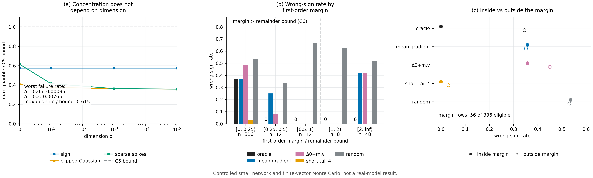

# N20 · 在实际状态上测量一阶统计量 — 实验

[← 框架总图](../README_ZH.md) · [证明](../proofs/N20_first_order_audit_ZH.md)

**结论.** N20 成立。

**(a)** **V9 — 与维数无关的估计.** 144 个单元格 × 20,000 次试验，共 2,880,000 个实例，全部 PASS。

- 每个经验失败率都远低于名义 $`\delta`$：$`\delta=0.05`$ 时至多 0.00095，$`\delta=0.2`$ 时至多 0.00765。
- 实测偏差分位数从不超过界的 0.615。
- 这个比值从 $`p=1`$ 到 $`p=100{,}000`$ 个参数都没有增长：$`p=1`$ 时为 0.615，所有更大的 $`p`$ 都是 0.574。

**(b)** **E12 — 按一阶 margin 选择，在冻结的 E6 held-out 面板上.**

- **(b)** 在一阶 margin 超过余项界的 56 行上，oracle 一阶分数 $`\langle\nabla V(x),\mu^{\rm cand}-\mu^{\rm ref}\rangle`$ **没有一次判错符号**，正如 [N20(b)](../proofs/N20_first_order_audit_ZH.md) 所要求的。
- **(b′)** 在同样这 56 行上，E6 的每个静态 proxy 都有 35.7% 判错，随机选择判错 53.6%。在 margin 内，这些 proxy 缺的是实际状态上的延续值梯度，即[N20(b′)](../proofs/N20_first_order_audit_ZH.md) 的条件 (i)。
- 在 margin 之外，即使 oracle 也在 28.7% 的合格行上判错；实测的四步尾段在这些行上只判错 3.0%。那里起决定作用的是高阶尾段效应，节点 [N17](N17_ced_method_ZH.md) 规定的正是在这里使用实测尾段。



[PDF](../figures/N20_first_order_audit.pdf)

## V9 · 平均增量的维数无关集中性

**动机.** [N20(a)](../proofs/N20_first_order_audit_ZH.md) 声称经验平均增量在任意维数下都以 $`b(1+\sqrt{2\log(1/\delta)})/\sqrt n`$ 的速率集中。LoRA adapter 有上千万个参数。如果存在维数依赖的失败，会表现为失败率超过 $`\delta`$，或者随 $`p`$ 增大，实测分位数逐渐逼近界。

**设置.**

- 维数 $`p\in\lbrace1,10,1000,100000\rbrace`$，样本量 $`n\in\lbrace8,32,128\rbrace`$，置信度 $`\delta\in\lbrace0.05,0.2\rbrace`$，单样本与两样本统计量都测。
- 三个 $`b=1`$ 的有界分布（`data.laws`）：
  - *sign：* 一个有偏的标量符号乘以固定的单位符号向量，即归一化的 sign 类增量（$`\eta=1/\sqrt p`$），$`P`$ 与 $`Q`$ 下均值不同；
  - *裁剪 Gaussian：* $`N(0,I/p)`$ 按范数 $`1`$ 裁剪；
  - *稀疏 spike：* 均匀选一个坐标，符号均匀，范数为 $`1`$。
- 高维合成量通过各向同性和 Beta 角递推精确采样，不显式构造 $`p`$ 维向量（`data.implicit_sampling`）。
- 每个单元格 20,000 次独立试验；种子 `SeedSequence([150150, 9])`。

**做法.** 在每个单元格中：

1. 记录偏差超过界的试验比例，并断言它不超过 $`\delta`$ 加四个二项标准误；
2. 记录偏差的经验 $`(1-\delta)`$ 分位数与界之比。

**结果**（`groups[id=V9].data.rows`）：

| $`p`$ | 单元格 | $`\delta=0.05`$ 时最差失败率 | $`\delta=0.2`$ 时最差失败率 | 最低覆盖率 | 最大分位数/界 |
|---:|---:|---:|---:|---:|---:|
| 1 | 36 | 0.00095 | 0.00765 | 0.99235 | 0.615 |
| 10 | 36 | 0.00030 | 0.00315 | 0.99685 | 0.574 |
| 1,000 | 36 | 0.00050 | 0.00355 | 0.99645 | 0.574 |
| 100,000 | 36 | 0.00040 | 0.00335 | 0.99665 | 0.574 |

按分布看，最大分位数/界分别为 0.574（sign）、0.408（裁剪 Gaussian）和 0.615（稀疏 spike）；总体最大值为 `data.max_quantile_over_bound` = 0.615。对 $`\delta=0.05`$ 下的单样本裁剪 Gaussian，这个比值在每个 $`n`$ 上都随 $`p`$ 从 0.406 降到 0.291。

**说明了什么.** 在每个单元格中，界都成立，且至少有 1.6 倍的余量；没有任何量随维数变差。对固定的增量界 $`b`$，这个界与维数无关。对未归一化的 sign 类增量，$`b=\eta\sqrt p`$，一阶差别也是同一尺度，所以相对精度仍由 $`1/\sqrt n`$ 决定（`data.caveat`）。

## E12 · 冻结 E6 面板上的一阶 margin

**动机.** [N20(b)](../proofs/N20_first_order_audit_ZH.md) 预测：只要一阶分数的 margin 超过余项界，它对两个反馈分布的排序就是对的。[N20(b′)](../proofs/N20_first_order_audit_ZH.md) 预测了节点 [N17](N17_ced_method_ZH.md) 中便宜 proxy（检验 E6）失败的原因：

- 在 margin 内，它们缺少延续值梯度，即条件 (i)；
- 在 margin 外，任何一阶分数都没有保证，即条件 (ii)。

E12 在 E6 评估这些 proxy 时所用的同一批行上检验这两个预测，不重新拟合任何东西。

**设置.**

- E6 的 held-out 面板与冻结的 proxy 模型，原样读取；前后 SHA-256 一致（`data.frozen_sha256_before`、`_after`）。
- 每一行是某个学习器状态上的一次候选更新，接着是声明的七次参照更新，并带有精确的完整尾段 gold 对比。
- oracle 分数为 $`\langle\nabla V^0(x),\mu^{\rm cand}-\mu^{\rm ref}\rangle`$，其中 $`\nabla V^0`$ 是该行参照尾段的精确延续值梯度。
- 余项界使用采样得到、不加垫的线段曲率。
- threshold 任务的 36 行回报不连续，违反 $`S_1`$，不适用 [N20(b)](../proofs/N20_first_order_audit_ZH.md)。
- 种子 `SeedSequence([150150, 112])`。

**做法.**

1. 对每一行计算 oracle 分数和余项界。
2. 按比值 $`\lvert`$score $`\rvert`$ / 界对行分组。
3. 分别在总体、各 split 和各比值区间上报告 oracle、每个冻结的 E6 proxy、实测短尾和随机选择的判错符号率。
4. 断言比值超过 1 时 oracle 没有判错。

按 E6 的约定，预测为零不算判错符号，只有 gold 非零的行才计入比率。

**结果 — 总体**（`groups[id=E12].data.summary[split=overall]`）：

| 量 | 数值 |
|---|---:|
| 行数 / 合格（光滑）行数 | 432 / 396 |
| margin $`>`$ 余项界的行数 | 56（占合格行的 14.1%） |
| margin 内 oracle 判错符号率 | **0** |
| 全部合格行上 oracle 判错符号率 | 0.287 |
| margin 内静态 proxy（输入矩、平均梯度、符号、$`\Delta\theta`$、$`\Delta\theta`$ + $`m,v`$） | 各为 0.357 |
| margin 内 1 步 / 4 步实测短尾 | 0 / 0 |
| margin 外 1 步 / 4 步短尾 | 0.203 / 0.030 |
| margin 内随机选择 | 0.536 |
| 完整尾段 gold | 0 |

**结果 — 按比值 $`\lvert`$oracle score $`\rvert`$ / 余项界**（`data.bins`）：

| 比值 | 行数 | oracle | 平均梯度 | $`\Delta\theta`$ + $`m,v`$ | 1 步短尾 | 4 步短尾 | 随机 |
|---|---:|---:|---:|---:|---:|---:|---:|
| $`[0,0.25)`$ | 316 | 0.371 | 0.371 | 0.485 | 0.221 | 0.033 | 0.533 |
| $`[0.25,0.5)`$ | 12 | 0 | 0.250 | 0.083 | 0 | 0 | 0.333 |
| $`[0.5,1)`$ | 12 | 0 | 0 | 0 | 0 | 0 | 0.667 |
| $`[1,2)`$ | 8 | 0 | 0 | 0 | 0 | 0 | 0.625 |
| $`[2,\infty)`$ | 48 | 0 | 0.417 | 0.417 | 0 | 0 | 0.521 |

**结果 — 按 split**（`data.summary`）：

| split | 合格行 | margin 行 | oracle 判错：margin 内 / 总体 |
|---|---:|---:|---|
| held-out 状态 | 72 | 16 | 0 / 0.234 |
| held-out $`\epsilon`$ | 72 | 16 | 0 / 0.281 |
| held-out 学习率 | 72 | 0 | — / 0.313 |
| held-out $`\epsilon`$ 与学习率 | 72 | 0 | — / 0.313 |
| fresh → warm | 72 | 16 | 0 / 0.234 |
| warm → fresh | 36 | 8 | 0 / 0.406 |
| held-out threshold 任务 | 0（36 行不适用） | — | — |

**说明了什么.**

- **[N20(b)](../proofs/N20_first_order_audit_ZH.md) 成立.** 只要一阶 margin 超过余项界，oracle 一阶分数在含有 margin 行的四个 split 中都从不排错。比值一旦超过 0.25 它也从不出错，说明经验余项界是保守的。
- **在 margin 内，静态 proxy 失败是因为缺少 $`\nabla V`$.** 在比值 $`\ge2`$、由一阶决定的 48 行上，静态 proxy 判错 41.7%，oracle 为 0%。它们用的是同样的更新统计量，却没有因状态和任务而异的延续值梯度，因此违反了 [N20(b′)](../proofs/N20_first_order_audit_ZH.md) 的条件 (i)。
- **在 margin 外，由尾段决定.** 在比值 $`<0.25`$ 的 316 行上，即使 oracle 也判错 37.1%，而实测的四步尾段只判错 3.3%。这个区间需要 N17 的实测短尾；在 $`S_1`$ 不成立的 threshold 任务上，则需要完整尾段。
- **在这个面板中 margin 很少成立.** 只有 14% 的合格行满足它，held-out 学习率的两个 split 中一行都没有，那里的步长是 pilot 配方的十倍（Adam $`\eta=0.1`$，SGD $`\eta=1`$；`theory/v015_checks/proxy_split_freeze.json`，`recipe_shift_axes`）。这与节点 [N18](N18_optimizer_transformed_response_ZH.md) 中余项的阶数一致。

## 复现

```bash
CUDA_VISIBLE_DEVICES='' theory/.venv/bin/python theory/v015_checks/check_v015.py --only V9,E12 --output theory/v015_checks/quick/n20.json
```

## 产物

- `theory/v015_checks/results_v015_independent.json`：`groups[id=V9].data`（`rows`、`laws`、`max_quantile_over_bound`、`caveat`）与 `groups[id=E12].data`（`summary`、`bins`、`cell_audits`、`limitations`、冻结哈希）。
- 原样使用的冻结输入：`theory/v015_checks/proxy_split_freeze.json` 与 `proxy_models_frozen.json`。
- 代码：`theory/v015_checks/otlr.py`（`check_V9`、`check_E12`）。
- 套件图：`theory/v015_checks/figs/V9.png`、`figs/E12.png`（以及 `.svg`）。
- 图：`../figures/N20_first_order_audit.pdf` 与 `.png`（规格 `../figures/specs/N20.md`）。
